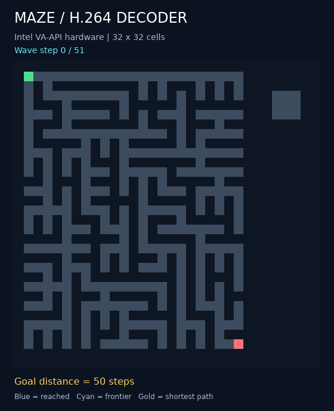

# Maze flood-fill decoder solver

An H.264 decoder expands a flood through a maze, in parallel across its pixels.
Walls block propagation. Only the maze and starting cells are stored as pixels;
every later picture contains prediction instructions without residual data.



*Captured from Intel VA-API decoding. The blue region grows; the sealed room
stays gray. The gold route is reconstructed afterwards from decoded arrival times.*

## How it works

Each cell is one luma pixel: **0 = wall, 128 = unvisited passage, 255 = reached**.
Five decoded pictures perform one step:

1. Isolate reached cells.
2. Check north/south neighbors using motion vectors and weighted prediction.
3. Check east/west neighbors.
4. Combine the neighbor results.
5. Use weighted arithmetic and clipping to block walls and retain reached cells.

This is four-neighbor breadth-first expansion. A cell's first reached iteration
gives its shortest hop distance from the nearest start. Python reads those times
from decoded output and traces a route through decreasing distances; it does not
precompute the flood. CPU BFS runs only with `--verify`.

## Run

Requires Python 3.10+ and FFmpeg. From this folder:

```sh
python3 run.py --verify --preview
python3 run.py --maze mazes/demo.txt --steps 60 --decoder vaapi --verify --preview
python3 -m unittest -v
```

Hardware decoding requires GStreamer's `vah264dec`. `--decoder openh264` provides
another independent decoder. ASCII input uses `#` walls, `.` passages, `S` starts
(multiple allowed), and an optional `G` goal. Dimensions are padded with walls
to multiples of 16; at 30 fps, the guarded picture must fit 60 macroblocks.

Outputs under `out/`: executable `.h264`, instruction manifest, distance/path JSON,
and optional GIF. The default step budget equals the open-cell count, guaranteeing
completion. With a smaller budget, unvisited cells remain **unresolved** until
convergence proves them unreachable.

Demo: **359 reachable cells, 9 unreachable cells, 50-step shortest path**.
The wave stops changing at step 51. All 243 local inputs pass on FFmpeg,
OpenH264, and Intel hardware.

[Executable stream](assets/maze.h264) · [Decoded distances and path](assets/distances.json) ·
[Exact arithmetic](DESIGN.md) · [Validation](VALIDATION.md)
