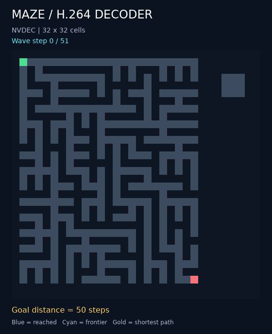

# Maze flood through the shared H.264 compiler

The current kernel uses **four pictures per expansion**, and the runner reads
back only completed flood states by default. The 52-step demo uses **214 decoded
pictures and 54 returned pictures**, down from 265 pictures with full readback.
[Measured comparison, proofs and captures](optimizations/README.md).

This variant expresses flood propagation in [the shared compiler DSL](../../05-h264-compiler/README.md).
The [kernel](maze_kernel.py) derives a terrain mask from the input:
0 for walls, 1 for passages, 2 for starts. Each step combines the four shifted
neighbors, blocks walls and preserves starts in one final threshold operation.
Every other reached cell persists through its reached predecessor.
Finite zero padding prevents movement across opposite boundaries.



The current [stream](optimizations/assets/maze.h264) reaches the goal in 50 hops and
converges at step 51, leaving the sealed nine-cell room unreachable. FFmpeg,
OpenH264, Intel VA-API and NVDEC produce identical raw bytes; every flood state
and arrival distance matches independent BFS. See [validation results](VALIDATION.md),
the [compiler manifest](optimizations/assets/maze.json), and
[decoded distances](optimizations/assets/maze.distances.json).

The input keeps the original byte encoding: walls are `0`, open cells are
`128`, and starts are `255`. Symbolic thresholds produce logical `0/1` masks.
The graph depends on dimensions and expansion budget; its instruction sequence
does not depend on maze contents. The H.264 decoder computes every flood state.

Run from the repository root:

```sh
python 02-maze-flood-fill-decoder-solver/compiled/run.py \
  --steps 52 --decoder ffmpeg --verify --preview \
  --output 02-maze-flood-fill-decoder-solver/compiled/out/maze.h264
```

`--maze PATH` loads an ASCII maze; `--random-seed N` chooses another fixture.
With no `--steps`, the open-cell count supplies a convergence-safe budget.
Use `--decoder openh264`, `--decoder vaapi`, or `--decoder nvdec` for an installed
alternative. NVDEC accepts `--helper PATH` or the `H264_NVDEC_DECODER` environment
variable; see [runtime setup](../../05-h264-compiler/native_ops/nvdec/README.md#reproduce).
`--readback outputs` is the default. NVDEC skips copies of unnamed intermediates;
the compatibility backends copy all pictures before host selection. `--readback
all` returns every picture for diagnostics. Distance JSON records actual decoded,
copied and returned counts. All flood states remain available in either mode.
`--no-optimize` disables compiler optimizations. FFmpeg renders previews.

The CLI saves the `.h264` stream and compiler `.json` manifest, decodes the saved
stream, and writes `.distances.json`. An optional `.gif` colors decoded states
and overlays the shortest route. Unvisited cells remain unresolved when the
budget ends before convergence.

```python
from maze_kernel import compile_maze, extract_solution

program = compile_maze(maze.width, maze.height, steps=52)
outputs = program.verify(maze.initial_luma(), backend="ffmpeg", readback="outputs")
solution = extract_solution(outputs, maze, steps=52)
```

Run this snippet from `compiled/`, or add that directory to `sys.path`.
`step_0` through `step_N` are decoded binary reachability grids; `passages`
is the decoded open-cell mask. Output picture indices are recorded in
`program.output_frames`. Extraction records the first decoded step that reaches
each cell, then walks decreasing distances to recover a route. It performs no
BFS. The independent BFS implementation runs only for verification.

Integration checks:

```sh
python -m unittest discover \
  -s 02-maze-flood-fill-decoder-solver/compiled -p 'test_*.py' -v
```

Tests cover all 243 local wall/open/reached configurations, every intermediate
state against BFS, sealed rooms, multiple starts, open boundaries, short and
zero budgets, input reuse, original-stream parity, and disabled-oracle execution.
FFmpeg, OpenH264, and VA-API paths are exercised when available; missing optional
backends are reported as skips.

The current demo stream has 214 pictures and 45,853 bytes. Original assets under
[`assets/`](assets/) preserve the first compiler's 560-picture, 148,540-byte
baseline. The earlier optimized kernel used 265 pictures; the specialized
original used 261. All variants compute the same states and shortest distances.
