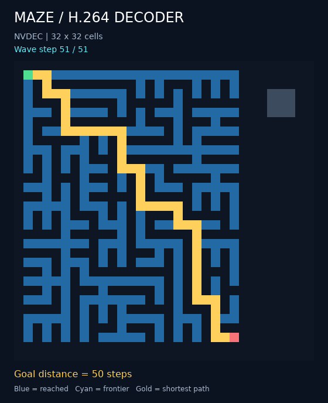

# Four-picture flood and selective readback

The maze kernel now takes four prediction pictures per expansion. The runner
returns every completed flood state and the passage mask, preserving shortest
distances and route extraction while omitting arithmetic intermediates from
NVDEC readback.



[Animated capture](assets/maze.gif) · [Executable stream](assets/maze.h264) ·
[Instruction manifest](assets/maze.json) · [Decoded distances](assets/maze.distances.json)

## Measured results

Same 32×32 maze, 52 expansions, decoder and current compiler in all four modes:

| Kernel / readback | Decoded pictures | Copied pictures | Returned bytes | NVDEC median |
| --- | ---: | ---: | ---: | ---: |
| Previous / all | 265 | 265 | 1,628,160 | 652.22 ms |
| Previous / named outputs | 265 | 54 | 331,776 | 638.80 ms |
| Four-picture / all | 214 | 214 | 1,314,816 | 578.70 ms |
| Four-picture / named outputs | **214** | **54** | **331,776** | **582.10 ms** |

Together: **19.2% fewer decoded pictures**, **79.6% fewer copied pictures/bytes**,
and **1.12× measured speedup** (10.8% lower latency). Relative to full readback of
the new kernel, selection removes 74.8% of copies. Selective readback alone shows
no clear latency improvement on this small workload; the four-picture kernel
accounts for the observed speedup. Five samples include outliers and fixed startup.

Each mode has one untimed warmup and five measured repetitions, rotating mode
order. Timings include single-job file assembly, process/pipeline startup,
parsing, decoding, readback, diagnostics and exact byte comparison. They exclude
compilation, input packing, network transfer, reference loading, route extraction
and rendering. [Every sample and actual helper copy count](assets/nvdec-results.json)
is retained. The baseline stream is byte-identical to the previously published
265-picture maze; both variants use the current compiler and the same input bytes.

## Why four pictures suffice

Construct static terrain `T = passages + starts`: walls are 0, passages 1,
starting cells 2. The symbolic update becomes:

```text
neighbors = north OR east OR south OR west
next = [T + neighbors >= 2]
```

Starts remain reached even when isolated. Every reached non-start has a reached
predecessor, so it persists without explicitly OR-ing in its current value.
Starting from the start mask, induction gives exactly the cells at distance at
most the iteration number. Walls stay blocked, and finite zero padding prevents
wraparound. This preserves every intermediate BFS state, not just connectivity.

The compiler's generic exact search emits these four B predictions:

```text
a = north OR east
b = a OR south
c = b + west                       # 0, 1 or 2
next = (3*T + c + 4) >> 3           # exactly 0 or 1
```

The final instruction uses weights `(3,1)`, denominator 2 and zero offsets.
Its nine-point truth table covers `T=0..2` and `c=0..2`; the manifest records
the exhaustive proof. The demo includes six setup pictures and `52*4`
prediction pictures. Zero-step programs prune unused terrain construction.
The 45,853-byte stream is 14.4% smaller than the 53,536-byte baseline.

`step_0..step_52` plus `passages` occupy 54 distinct physical pictures. `output`
aliases `step_52` and needs no extra copy. NVDEC decodes all 214 pictures to
preserve reference dependencies, but only those 54 undergo surface copies and
CPU readback. FFmpeg, OpenH264 and VA-API currently copy all pictures before
selecting outputs on the host; the runner reports that actual copy count.

## Verification and reproduction

**184 local tests pass**, including 19 compiled-maze tests, 78 shared-compiler
tests and six comparison-tool tests. The paired suite checks ten cases: the
demo, all 243 local configurations, isolated/multiple starts, zero and short
budgets, three random mazes, and a 463-hop corridor. Every state, bounded distance,
convergence point and route agrees with independent BFS. Both variants' full
**5,302 pictures / 31,286,784 I420 bytes** match FFmpeg, OpenH264, VA-API and
NVDEC. NVDEC additionally validates selected readback for both variants on all
ten cases. All 607 named planes per variant agree, including output aliases.

From the repository root:

```sh
python3 02-maze-flood-fill-decoder-solver/compiled/run.py \
  --steps 52 --decoder nvdec --helper decoder_core/.build/nvdec_decode \
  --verify --preview --output 02-maze-flood-fill-decoder-solver/compiled/out/maze.h264
```

The default is `--readback outputs`; use `--readback all` for every intermediate.
The shared compiler also supports `program.decode(image, backend="nvdec",
readback="outputs")` and the same keyword on `verify()`. Encoding and prediction
instructions are identical between readback modes.

Prepare local reference data:

```sh
python3 02-maze-flood-fill-decoder-solver/compiled/optimizations/prepare.py \
  --output 02-maze-flood-fill-decoder-solver/compiled/out/optimization-bundle
```

Copy the bundle, `benchmark.py` and [NVDEC runtime](../../../05-h264-compiler/native_ops/nvdec/README.md#reproduce)
to the decoder host, preserving the repository layout, then run:

```sh
python3 02-maze-flood-fill-decoder-solver/compiled/optimizations/benchmark.py BUNDLE \
  --helper decoder_core/.build/nvdec_decode --output RESULTS
```

The portable runner needs Python 3.8; compilation uses Python 3.10+. After copying
results back, run `capture.py BUNDLE RESULTS --output ASSETS` from this directory
to render the verified selected pixels. The capture generator checks hashes,
reads the packed output through the compiler API and reconstructs the route
from decoded arrivals. [Bundle/source hashes and BFS references](assets/bundle.json)
and [capture provenance](assets/capture.json) accompany the report. Large raw
references and generated case streams remain under ignored `out/`.
