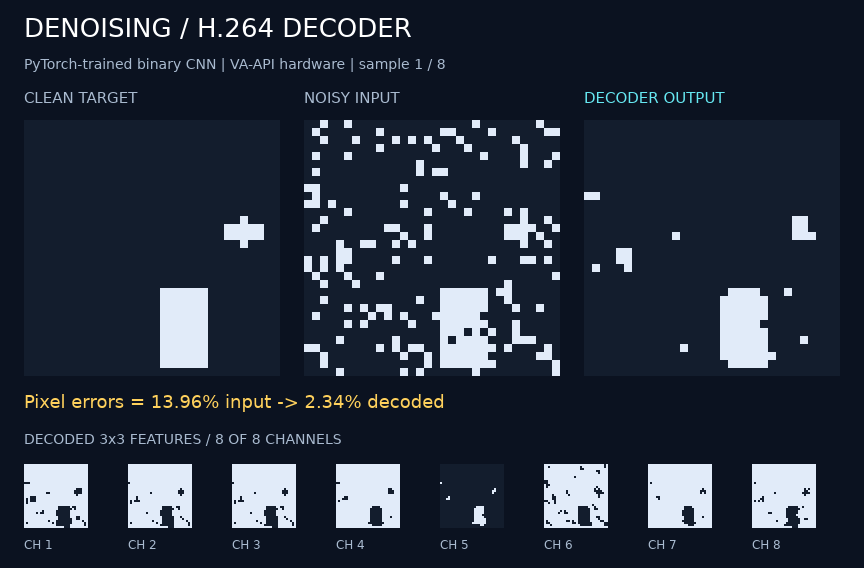

# Denoising decoder

A tiny binary CNN is **trained in PyTorch**, frozen, and compiled into H.264.
The video decoder performs its inference: eight learned 3×3 filters, binary
activations, then a learned 1×1 layer. Only the noisy input is stored as pixels;
later pictures contain prediction instructions without residual data.



*Actual VA-API hardware output. The bottom row contains the eight decoded feature
maps. Labels, enlargement, and the clean reference are presentation added afterwards.*

## Results

On **256 held-out synthetic binary images**, corrupted by independent 15% bit flips:

| Output | Wrong pixels |
| --- | ---: |
| Noisy input | 15.07% |
| Trained model, executed by H.264 decoder | **3.29%** |
| Ordinary 3×3 majority filter | 3.34% |

This demonstrates learned inference inside a decoder, with quality comparable to
the simple filter on this toy dataset. It is not a general photo denoiser.

## Run

Python 3.10+ and FFmpeg suffice for frozen inference; PyTorch is needed only to
train or check the original checkpoint. From this directory:

```sh
python3 run.py --verify --preview
python3 run.py --decoder vaapi --verify --preview
python3 run.py --samples 256 --seed 200000 --verify
python3 -m unittest -v
```

Hardware requires GStreamer with `vah264dec`; `--decoder openh264` checks another
software decoder. Outputs under `out/` include the executable stream, instruction
manifest, quality report, and optional PNG/GIF captures. Use `compile_batch()` for
your own 0/1 image arrays, with dimensions accepted by the shared writer.

Each image takes **98 decoded pictures**, including five copies that preserve
reference data. Channels are computed in sequence and accumulated immediately
into the 1×1 layer, avoiding the need to keep all feature maps live.

## Retrain

The recorded CPU training environment uses Python 3.12:

```sh
uv venv .venv --python 3.12
uv pip install --python .venv/bin/python --index-url https://download.pytorch.org/whl/cpu 'torch==2.5.1+cpu'
uv pip install --python .venv/bin/python 'numpy==2.2.6'
.venv/bin/python train.py
.venv/bin/python -m unittest -v
```

Training exports frozen [weights](model/weights.json), the PyTorch checkpoint,
and [training metrics](model/training.json). Retraining with the recorded seed
reproduced the frozen weights byte-for-byte locally.

[Executable demo](assets/denoising.h264) · [Compiler instructions](assets/program.json) ·
[Exact arithmetic](DESIGN.md) · [Validation](VALIDATION.md)
