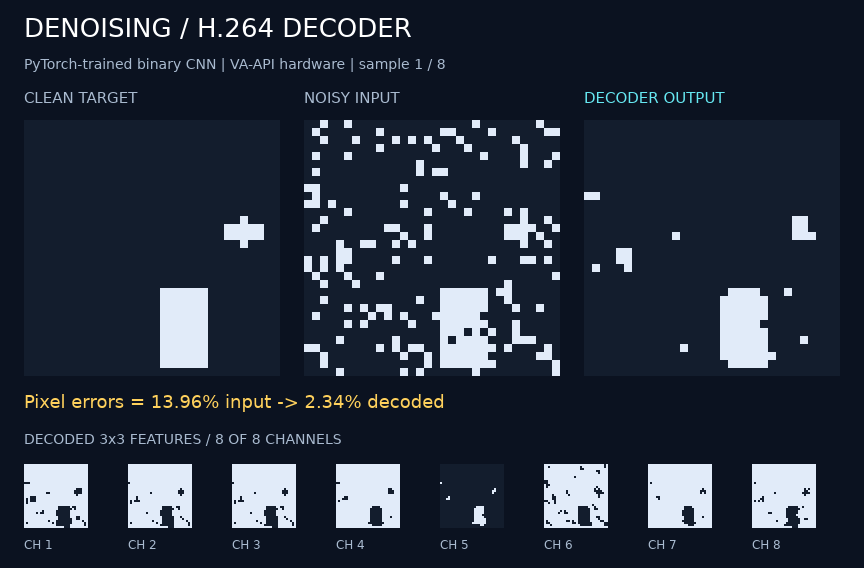

# Denoising through the shared compiler

This version loads the original frozen `../model/weights.json` unchanged. Its
eight 3×3 signed binary convolutions and learned 1×1 combination are expressed
using `h264.conv2d_binary` and `h264.binary_dot`. The compiler generates decoder
instructions from weights; compilation and encoding do not call model inference.

```sh
python3 run.py --verify --preview
python3 run.py --decoder vaapi --verify --preview
python3 -m unittest discover -s . -p 'test_*.py' -v
```

Run these commands from this directory. Python and FFmpeg suffice; checkpoint
parity tests also require the original experiment's PyTorch environment. Tests
run every available decoder and compare actual output and all feature pixels
with the unchanged integer model. The instruction tail remains byte identical
when input pixels change.

Compare the original 256-image held-out set with both the integer model and
actual PyTorch checkpoint using the original training environment:

```sh
../.venv/bin/python run.py --samples 256 --seed 200000 --verify --verify-checkpoint --output out/held-out.h264
```

The output stream, instruction manifest, and measurements go under `out/`.
`--preview` reuses the original capture renderer with actual decoded feature and
output planes. Values read from the shared compiler are binary 0/1. The original
experiment's code, weights, checkpoint, and assets remain unchanged.

The recorded 256-image held-out run matches every integer-model and actual
PyTorch feature/output bit. Pixel error remains **3.2932%**, from **15.0715%**
noisy input. Common-expression elimination shares repeated convolution work,
reducing this program from the original 98 pictures/image to **74 pictures/image**.
Tests also cover all 512 possible 3×3 patches, edge padding, and identical
instruction bytes under changed inputs on FFmpeg, OpenH264, and Intel VA-API.



[Recorded decoder run](assets/demo.json) · [Held-out validation](assets/held-out.json) ·
[Executable stream](assets/denoising.h264) · [Graph and instructions](assets/program.json)
