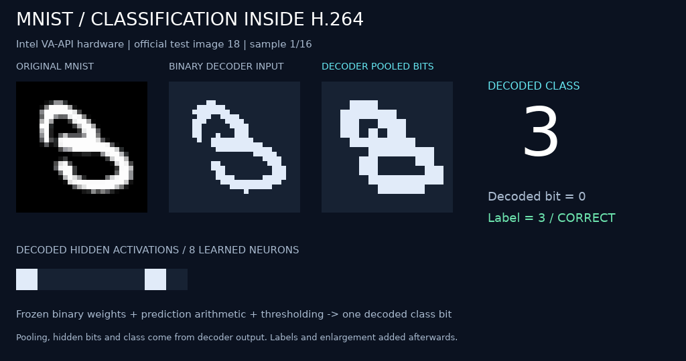

# Binary MNIST classification decoder

A PyTorch-trained binary network classifies handwritten **3s versus 8s** inside
an ordinary H.264 decoder. The decoder performs pooling, signed weighted sums,
hidden thresholds, and the final class decision. Only input pixels are seeded;
subsequent pictures contain prediction instructions without residual data.



*Original test digits in dataset order. Pooled features, hidden bits, and class
bits come from Intel VA-API decoding. Labels and enlargement are added afterwards.*

**Test accuracy: 94.96% — 1,884 / 1,984 digits.** Every decoded pooled bit,
hidden activation, and prediction matched the frozen model. The original
PyTorch checkpoint also matched all test-set hidden activations and predictions.

| Actual digit | Predicted 3 | Predicted 8 |
| --- | ---: | ---: |
| 3 | 952 | 58 |
| 8 | 42 | 932 |

The network uses binary 28×28 input, 2×2 max pooling, **196 → 8 → 1** binary
neurons, 1,576 signed weights, and nine thresholds. Eight digits run in parallel
per 1,802 decoded pictures. The full software test took 55.24 seconds for
decoding and readback, about **36 digits/second**; instruction generation,
seed encoding, and verification take additional time. This demonstrates decoder
computation, with substantial overhead compared with ordinary neural inference.

## Run

Python 3.10+ and FFmpeg are sufficient; PyTorch is only needed for training and
checkpoint tests. From this directory:

```sh
python3 run.py --verify --preview
python3 run.py --decoder vaapi --verify --preview
python3 run.py --samples 0 --verify --output out/test-set.h264
python3 -m unittest -v
```

The first run downloads checksum-verified MNIST test files. `--samples 0` uses
all official test images labeled 3 or 8; the complete stream is approximately
517 MB. `--decoder openh264` selects another software decoder. Hardware requires
GStreamer with `vah264dec`. Outputs under `out/` include the stream, per-image
predictions, timing/accuracy report, instruction manifest, and optional captures.
Tests use the small checked-in fixture and do not download the dataset.

## Train

```sh
uv venv .venv --python 3.12
uv pip install --python .venv/bin/python --index-url https://download.pytorch.org/whl/cpu 'torch==2.5.1+cpu'
uv pip install --python .venv/bin/python 'numpy==2.2.6'
.venv/bin/python train.py
.venv/bin/python -m unittest -v
```

Training uses 10,982 images and reserves 1,000 other training-split images for
validation. The official test split is excluded from training and selection.
Frozen weights, the PyTorch checkpoint, and selection/training records are in
`model/`. Retraining reproduced the frozen weights byte-for-byte locally.

This is a two-class model: other digits are still classified as either 3 or 8.
It makes 100 mistakes on the test set; correct decoder execution does not imply
perfect recognition.

[Executable hardware demo](assets/mnist.h264) · [Test report](assets/test-set.json) ·
[Every test prediction](assets/predictions.csv) · [Exact construction](DESIGN.md) ·
[Validation](VALIDATION.md)
