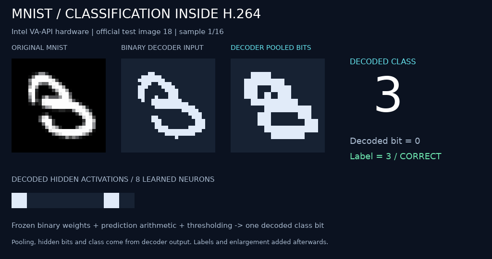

# Binary MNIST through the shared compiler

The original frozen 3-versus-8 network is expressed using shared compiler
primitives: `shift`, `add`, `threshold`, and `binary_dot`. It retains the original
2×2 pooling, 196 → 8 → 1 signed binary network, input preprocessing, and frozen
weights. Eight 28×28 inputs occupy a 128×64 board with 32-pixel tile spacing.
Class bits are read from actual decoded tile anchors; pooled and hidden bits
also come directly from decoder output.

From this directory:

```sh
python3 run.py --fixtures --verify --preview
python3 run.py --fixtures --decoder vaapi --verify --preview
python3 run.py --samples 0 --verify --output out/test-set.h264
python3 -m unittest discover -s . -p 'test_*.py' -v
```

The fixture run and tests work offline. Other runs use the original MNIST cache
at `../data/`, downloading checksum-verified data only if absent. Full test-set
execution uses every official test 3 and 8, without training. PyTorch is optional
and only needed for the checkpoint parity test; the original denoiser's `.venv`
provides that environment when present.

To additionally compare every decoded pooling cell, hidden neuron, and output
with the actual PyTorch checkpoint, use that Python environment and add
`--verify-checkpoint`. For example, from this directory:

```sh
../../03-denoising-decoder/.venv/bin/python run.py --samples 0 --verify --verify-checkpoint --output out/test-set.h264
```

Each batch uses the same compiled prediction bytes. New inputs replace only
the seed picture. Compilation/encoding never invoke host model inference;
`--verify` separately compares pooling, hidden bits, and final decisions with
the unchanged original integer model. Run reports include accuracy, prediction
records, stream and instruction hashes, and timing measurements. `--preview`
reuses the original capture renderer with decoded values.

The recorded full test run reproduces **94.96% accuracy (1,884 / 1,984)**.
Every decoded pooled cell, hidden neuron, and class bit matches both the
unchanged integer model and actual PyTorch checkpoint. All 1,984 prediction
and hidden-bit records also match the original experiment's checked-in results.

| Actual digit | Predicted 3 | Predicted 8 |
| --- | ---: | ---: |
| 3 | 952 | 58 |
| 8 | 42 | 932 |

This generic compiler emits **1,826 pictures per eight-digit batch**, versus
1,802 from the original specialized compiler. It preserves decisions without
claiming a reduction in this workload. The three decoder backends pass the
offline fixture tests. The animated demo shows 16 Intel VA-API classifications.



[Recorded demo](assets/demo.json) · [Full test results](assets/test-set.json) ·
[Original-result parity](assets/original-parity.json) ·
[Executable stream](assets/mnist.h264) · [Graph and instructions](assets/program.json)
