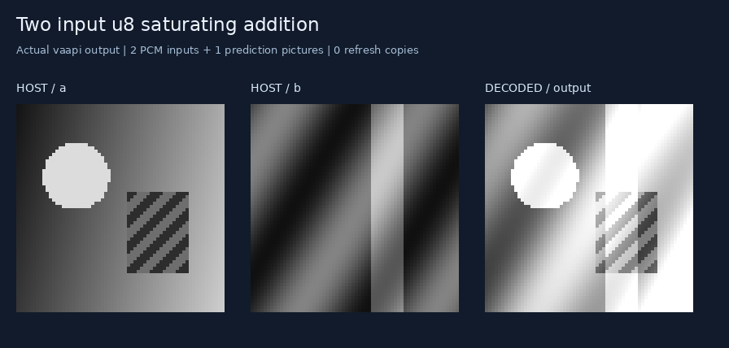
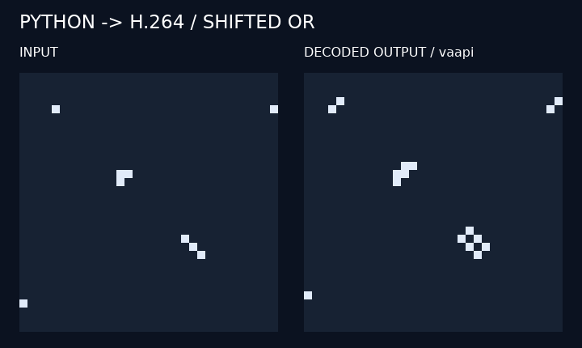

# A tiny Python → H.264 compiler

**Frontend status: deprecated for new work.** Start new kernels with
[experiment 09's shared compute IR](../09-codec-compute-ir/README.md), including
its API migration guide. Existing `h264` programs and packed workloads remain
available here. This directory is also still required by the shared H.264
adapter, which reuses its selector, reference scheduler and reader. Deprecation
does not remove those backend components or change existing imports.

Write a restricted Python image kernel, compile it once, and let an ordinary
video decoder execute its arithmetic. One shared graph, instruction selector,
reference scheduler, and backend now serve variants of all four earlier experiments.

[Compiler optimizations and measurements](optimizations/README.md) cover direct
Boolean predictions, shorter thresholds, exact affine fusion, grouped slices,
and retained reference slots. The same saved graphs use fewer pictures and
bytes while preserving every named output.

[Bounded exact instruction search](optimizations/exact-search/README.md) now
replaces small scalar subgraphs with exhaustively verified prediction sequences.
Life's rule drops from ten predictions to three; denoising also becomes smaller.
Pass `exact_search=False` to isolate the earlier optimizations.

[Semantic IR and mixed prediction packing](optimizations/ir/README.md) add
truth-table value propagation before instruction selection. Equivalent Boolean
expressions share results, input identities become aliases, and constants lose
their dead dependencies. Forty repeated XORs now need **zero arithmetic
pictures instead of 151**. Compatible P and B predictions can also share packed
pictures, reducing the four-tile denoiser from **20 to 19 total pictures**.
Both passes are enabled by default; `semantic_ir=False` disables value propagation.
Use `pack(..., mixed_predictions=False, scheduling="stable")` to reproduce the
earlier homogeneous packing baseline.

[Cost-aware packed scheduling](optimizations/packing/README.md) now reduces
four-tile denoising further, from **19 to 17 pictures**, with the same canvas and
output readback. It prioritizes long dependency chains when doing so also avoids
increasing prediction slices and bytes. These are static work reductions;
the earlier decoder timings do not measure this pass.

```python
import h264

@h264.kernel
def neighbor_or(image):
    right = h264.shift(image, dx=1, dy=0)
    below = h264.shift(image, dx=0, dy=1)
    return h264.threshold(h264.add(right, below), 1)

program = h264.compile(neighbor_or, width=32, height=32)
image = [[0] * 32 for _ in range(32)]
image[16][16] = 1
program.save("compute.h264", image)  # also writes compute.json
result = program.verify(image, backend="ffmpeg")["output"]
```

Run from this directory, or add it to `PYTHONPATH`. Compilation receives symbolic
images and static dimensions; input pixels enter only during encoding.
The prediction bytes in `program.tail` are reusable with different inputs.
`verify()` decodes and separately checks every named output pixel against an
integer graph interpreter. `decode()` returns actual decoder output without
that reference calculation; `read(raw_yuv)` inspects an existing decode.

## Native image operations

Version 0.2 adds independent input pictures, explicit saturating affine
arithmetic, per-block gathers, and exact quarter-pixel interpolation:

```python
program = h264.compile(
    lambda a, b: h264.saturating_add(a, b),
    width=64, height=64,
    input_ranges={"a": (0, 255), "b": (0, 255)},
)
program.save("add.h264", {"a": image_a, "b": image_b})
```

This produces **three pictures**: two literal input pictures and one B-picture
computing `min(255, a+b)`. Loading the second input preserves the first reference.

[Six native-operation demos](native_ops/README.md) include addition,
brightness/contrast, tile permutation, blockwise warp, fractional translation,
and a chain retaining both original inputs. Each includes an executable stream,
manifest, and captures from actual decoding. The [benchmark](native_ops/BENCHMARK.md)
separates host input packing from decoding and compares fresh inputs with
resident references. Tests run on FFmpeg, OpenH264, and Intel VA-API.
[NVDEC validation](native_ops/nvdec/README.md) also passed all 34
hardware cases: 6,116 pictures matched byte-for-byte, including all four compiled
experiments. Desktop CUVID and SDK 13.1 direct-array output remain untested.



[Experiment 06](../06-motion-mask-decoder/README.md) combines frame differences,
thresholding, and morphology into motion masks. It also adds one-session batch
execution and selective NVDEC output readback to the shared runtime.

## Packing independent predictions

`h264.pack(program, tiles=8)` schedules independent lowered operations into
separate rectangles of shared pictures. It preserves named outputs and reuses
the same frozen prediction tail across inputs:

```python
packed = h264.pack(program, tiles=8)
packed.save("packed.h264", image)
outputs = packed.verify(image, readback="outputs")
```

Logical `width`/`height` stay unchanged; `writer.width`/`writer.height` describe
the larger coded canvas. `output_regions` locates each named output by picture,
tile, and rectangle. Coordinates exclude the outer 16-pixel guard. The manifest
also records active tiles, original instruction locations, and reference slots.

Packing defaults to `scheduling="auto"`: it constructs both the original stable
schedule and a critical-path schedule, validates their reference and codec
limits, and measures their encoded tails. It chooses the alternative only when
pictures, slices, prediction bytes, and named-output readback do not increase,
with at least one strict improvement. Equal costs retain the stable schedule.
`scheduling="stable"` preserves FIFO grouping; `scheduling="critical"` lets you
inspect its tradeoffs explicitly. Manifests record both candidate costs and any
legality failures. This bounded comparison adds compilation work; the selected
tail remains cached and reusable during execution.

The first version supports 1–16 tiles, uniform integer motion within ±16 pixels,
and the existing P/B arithmetic. It rejects fractional interpolation, block
gathers, nested packing, oversized canvases, and excessive reference or slice
costs. Zero gaps prevent shifted reads from reaching another logical image;
`read()` checks those gaps and unused tiles as well as chroma and outer guards.
Selected readback validates only the supplied pictures. Packing is opt-in:
fewer pictures can require more pixels, larger PCM inputs, and more readback.

[Experiment 07](../07-packed-denoising-decoder/README.md) compares two, four, and
eight tiles on the unchanged denoiser. Eight tiles reduce 52 pictures to 17,
while increasing decoded luma samples by 1.86×.

[Experiment 08](../08-decoder-compute-limits/README.md) establishes exact minima
for all 16 two-input Boolean functions under an explicit P/B model. XOR and XNOR
need three scalar instructions or two packed computation pictures. It also
compares alternative instruction dependencies, measures decoder costs, and
tests denoising alongside CUDA workloads. Its witness emitter is experimental;
it does not replace the compiler's current lowering or scheduler.

## Original binary example



The current compiler needs **three pictures**: visible seed, binary normalization,
and a direct shifted OR prediction. The saved original example uses four.
Results are logical 0/1 values; the capture
enlarges them and maps 1 to white. The executable stream contains computation
pictures, not a precomputed presentation animation.

## Compiled experiments

| Variant | Workload | Specialized original | First compiler | Optimized compiler |
| --- | --- | ---: | ---: | ---: |
| [01 Life](../01-conways-decoder-of-life/compiled/README.md) | 40 generations | 561 | 922 | **402** |
| [02 Maze](../02-maze-flood-fill-decoder-solver/compiled/README.md) | 52 steps | 261 | 560 | **214** |
| [03 Denoiser](../03-denoising-decoder/compiled/README.md) | One image | 98 | 74 | **52** |
| [04 MNIST](../04-binary-mnist-classification-decoder/compiled/README.md) | Eight digits | 1,802 | 1,826 | **1,589** |

Each variant includes a kernel, CLI, tests, executable demo, instruction manifest,
and actual hardware capture. Existing implementations and trained weights remain
available unchanged. Saved assets in those folders document the first compiler;
running their kernels now uses the optimized compiler. The comparison suite
checks all saved generations, flood states, denoiser features and classifier
activations. Earlier full-dataset accuracy measurements remain in their reports;
this optimization run uses the saved demo inputs.

Maze's current figure includes its revised four-picture recurrence. Recompiling
the historical five-picture graph still uses 265 pictures. Its runner now reads
back 54 completed-state/passage pictures; see the [paired comparison](../02-maze-flood-fill-decoder-solver/compiled/optimizations/README.md).

## Run and inspect

Python 3.10+ and FFmpeg suffice. Optional OpenH264 and Intel VA-API execution
use the same GStreamer backends as earlier experiments. The optional
[NVDEC backend](native_ops/nvdec/README.md#reproduce) uses a small C++ helper
to preserve exact full-range bytes during hardware readback.

```sh
python3 run.py --preview
python3 run.py --decoder vaapi --preview
python3 -m unittest -v
```

`program.h264` contains the seed and prediction instructions. Its sibling
`program.json` records the graph, proven ranges, scheduled pictures, physical
references, slot assignments, named output frame numbers, hashes, and execution
costs. Inspect `program.costs` for picture, slice, byte and lifetime counts.
See the [small example manifest](assets/shifted-or.json).

`program.decode(image, backend="nvdec", readback="outputs")` returns all named
outputs while NVDEC copies only their unique physical pictures. `verify()` accepts
the same option; the default remains `readback="all"`. `output_picture_indices`
exposes the sorted selection, and `read(raw, selected_frames=indices)` reads those
packed I420 pictures without fabricating missing intermediates. FFmpeg, VA-API
and OpenH264 currently perform full readback before host selection.

See [API and exact semantics](DESIGN.md) and [validation](VALIDATION.md) for
compiler tests, exhaustive byte arithmetic and interpolation checks, and
comparisons with the original neural models.
