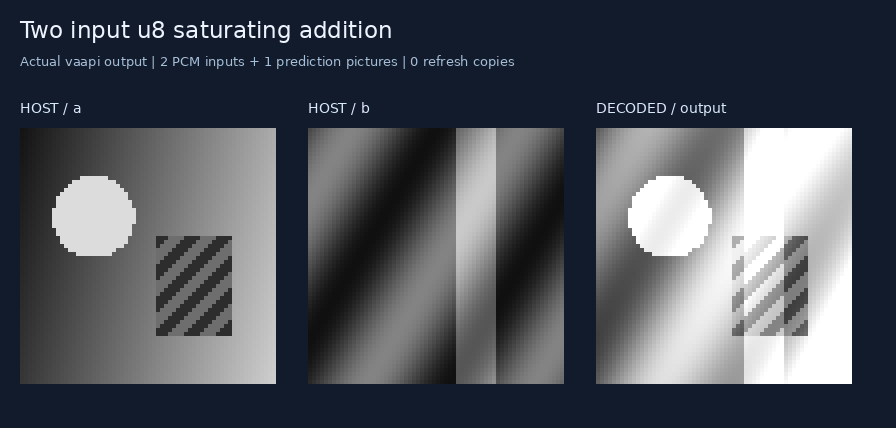
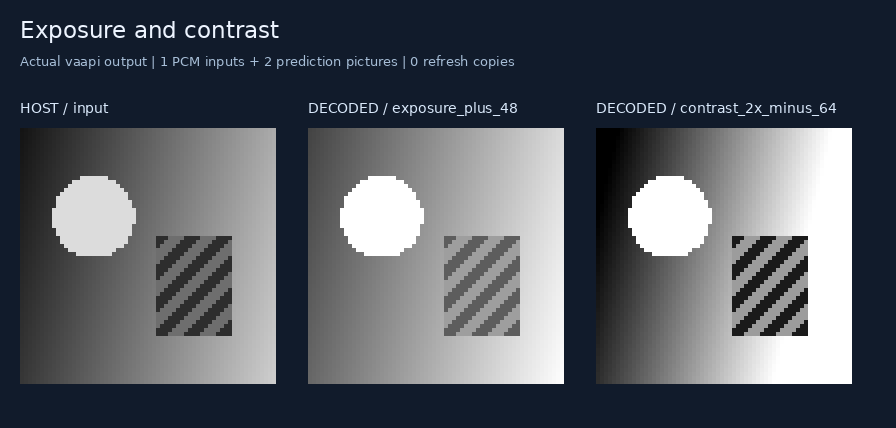
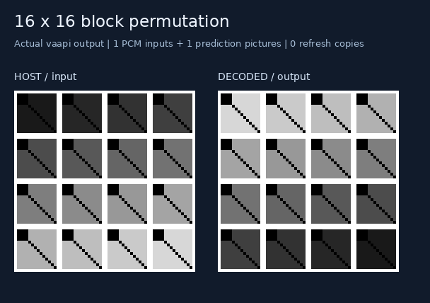
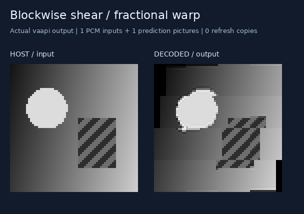
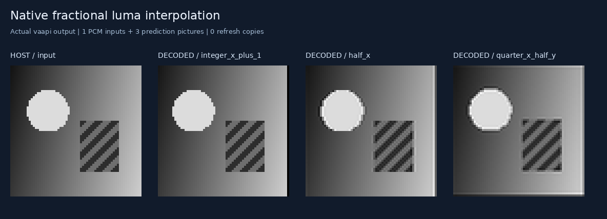
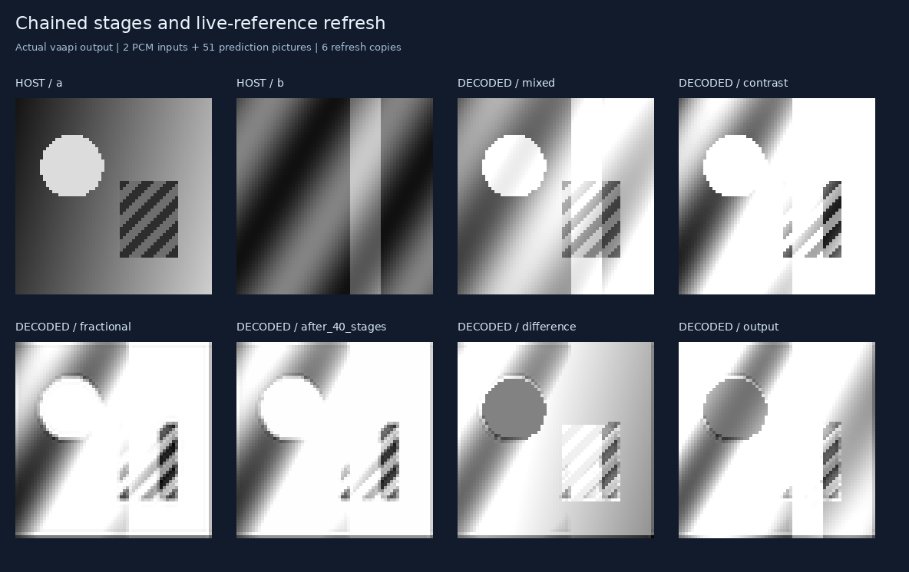

# Native decoder operations

Six small image kernels exercise operations already implemented inside ordinary
H.264 decoders: weighted prediction, saturating arithmetic, reference selection,
block motion, and fractional luma interpolation. Input pixels arrive in PCM
pictures. Compiled prediction bytes contain the instructions and can be reused
with different input pixels.

All examples use 64 × 64 active grayscale pixels inside a zero guard. Every
named output matches the independent integer interpreter on **FFmpeg, Intel
VA-API, and OpenH264**. The checked captures use the actual decoded output
planes. A subsequent [NVDEC run](nvdec/README.md) passed these demos,
exhaustive byte addition, interpolation, reference scheduling, and all four
compiled experiments: 34 cases and 6,116 pictures matched exactly.

The captures on this page use **Intel Raptor Lake-P Iris Xe Graphics**. The six demos check
172,032 named-output pixel values across the three decoders, plus guards,
neutral chroma, picture counts, and output ranges.

```sh
# Run from 05-h264-compiler. Pillow renders the captures.
python3 native_ops/demos.py
python3 native_ops/benchmark.py --steps 32 --repeats 3
```

`--decoders ffmpeg vaapi openh264` selects backends. The default checks all three
that are installed and records unavailable backends explicitly. Generated
streams and manifests are in [streams/](streams/); original-size pixel captures
are in [captures/](captures/). [results.json](results.json) records exact output
hashes, decoder checks, physical frame numbers, refresh counts, and byte costs.

## Two input saturating addition

```python
def add(a, b):
    return h264.saturating_add(a, b)

program = h264.compile(add, width=64, height=64,
                       input_ranges={"a": (0, 255), "b": (0, 255)})
result = program.verify({"a": image_a, "b": image_b}, backend="vaapi")
```

The result is `clip(a + b, 0, 255)`. Two PCM input pictures and one weighted
biprediction picture produce the result. Different operands reuse the same
prediction tail.



## Exposure and contrast

`saturating_weighted(image, bias=48)` brightens the image.
`saturating_weighted(image, w=2, bias=-64)` changes contrast and clips both
extremes. These are integer affine transformations of grayscale samples; they
are not gamma-aware photographic exposure adjustments.



## Block permutation and blockwise warp

`gather(image, offsets=[...])` selects one source displacement per active
16 × 16 block, in row-major destination order. Each offset is measured in
quarter pixels. To copy source block `(sx, sy)` into destination block
`(dx, dy)`, use `((sx-dx)*64, (sy-dy)*64)`.

The first example reverses the block grid while preserving each block's local
orientation. The second varies horizontal displacement by block row and vertical
displacement by block column. It demonstrates a piecewise motion field;
discontinuities between blocks are intentional.





## Fractional translation

`sample(image, qx=1, qy=2)` samples the input at `(x + 1/4, y + 1/2)`.
Positive offsets therefore move visible content toward the opposite direction.
Half-pixel locations use H.264's normative six-tap interpolation; quarter-pixel
locations use its specified combinations and rounding. The source outside the
active image is zero. Interpolation near that boundary can mix visible samples
with zeros; it is not a wraparound operation.

The comparison shows an integer displacement, horizontal half-pixel
displacement, and mixed quarter/half-pixel displacement. Nearest-neighbor
enlargement preserves the decoded grayscale sample values in these figures.



## Chained stages and retained references

The final kernel mixes two images, changes contrast, applies fractional motion,
runs forty small saturating bias stages, and combines the result with both
original inputs. Six named outputs expose the intermediate pictures.

The compiler emits **45 computation pictures and 6 reference-refresh copies**
after the two PCM input pictures: **53 pictures total**. Refresh copies preserve
original operands beyond the decoder's 16-picture reference window. Named
outputs identify physical picture indices; they can be read back even after
their reference storage is no longer needed.



## Cost and limits

See [BENCHMARK.md](BENCHMARK.md) and [benchmark.json](benchmark.json). Compilation,
first prediction-tail construction, cached-tail access, input PCM encoding, and
complete decode/readback are measured separately. Fresh independent pairs are
measured both with separate decoder starts and concatenated in one decoder
session, then compared with a long chain retaining its operands in decoder
reference storage. Fresh operand fixtures are precomputed on the host; host
feedback-loop costs are not modeled. Separate input-loading timings compare
encoding all fresh pairs with loading one resident pair. Decoder measurements
include process startup and all-picture readback.
They do not measure isolated GPU kernels or establish a GPU arithmetic speedup.

The active example size is deliberately small. The writer enforces its declared
H.264 level, picture/slice rate, initial-picture byte limits, and reference-window
constraints. This interface handles planar unsigned 8-bit grayscale values;
chroma stays neutral. `gather` selects block displacements, not arbitrary
per-pixel indices. Programs remain finite streams with statically chosen shapes
and operation counts.

## Desktop NVIDIA and SDK 13.1 — untested

NVDEC hardware decoding is now [tested with its own backend](nvdec/README.md).
The desktop CUVID recipe and direct-array API below remain untested.

NVIDIA Video Codec SDK 13.1 documents registering application-allocated CUDA
arrays with `cuvidRegisterDecodeSurfaces()` and submitting asynchronous decoding
with `cuvidDecodePictureAsync()`. This delivers decoded output directly into
registered block-linear arrays. The documented output path does not establish
an API for injecting arbitrary host images as H.264 prediction references.
That distinction follows from the described allocation/decode/consume workflow.
See [NVDEC guide, section 5](https://docs.nvidia.com/video-technologies/video-codec-sdk/13.1/nvdec-video-decoder-api-prog-guide/index.html#nvdec-direct-output-to-block-linear-cuda-arrays).

On a machine with supported NVIDIA hardware, its driver, and FFmpeg built with
CUVID support, this is an **untested recipe**, not an implemented backend:

```sh
# Run from this native_ops directory. Explicit decoder selection prevents
# silently substituting the software H.264 decoder.
ffmpeg -v error -xerror -hwaccel cuda -hwaccel_output_format cuda \
  -c:v h264_cuvid -i streams/saturating-add.h264 \
  -map 0:v:0 -fps_mode passthrough -vf 'hwdownload,format=nv12' \
  -pix_fmt nv12 -f rawvideo decoded-nvdec.nv12
```

The recipe downloads full decoded frames to the host for inspection; it does
not exercise SDK 13.1 direct-array output. This 64 × 64 example has coded
96 × 96 pictures including guards, so each NV12 picture occupies 13,824 bytes.
Use the manifest's output frame number and extract the first 9,216 luma bytes
of that picture, then remove the 16-pixel guard. Compare those values exactly
with the saved capture before reporting success. NVIDIA's
[FFmpeg setup guide](https://docs.nvidia.com/video-technologies/video-codec-sdk/13.0/ffmpeg-with-nvidia-gpu/index.html)
describes the required hardware, driver, and build support.
