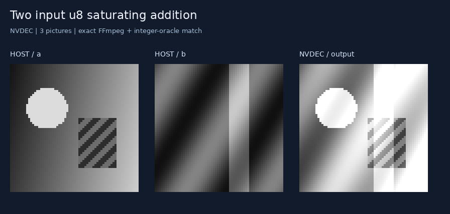
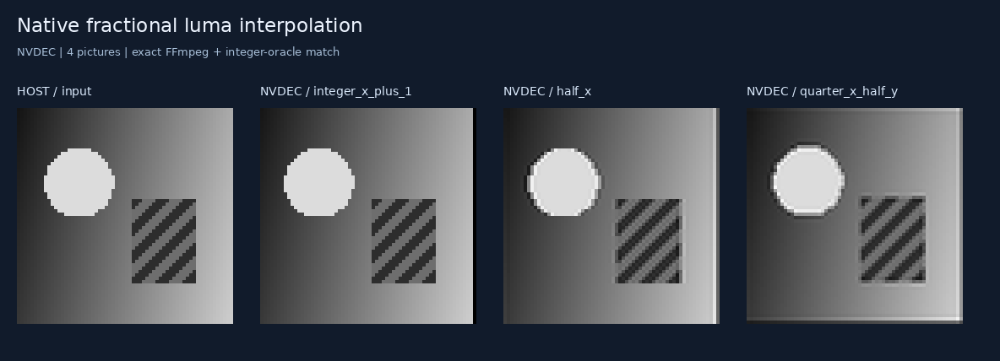

# NVDEC validation

**NVDEC passed all 34 cases: 6,116 pictures and 101,193,216 I420 bytes matched
FFmpeg exactly.** All 300 named outputs also matched independently evaluated
integer graphs. The H.264 streams and decoder were unchanged.

The helper uses NVIDIA's GStreamer `nvv4l2decoder` plugin. Validation covers
this NVDEC path; desktop CUVID and direct output into application CUDA arrays
were not tested.

## What passed

| Workload | Coverage |
| --- | --- |
| Six native demos | Saturating addition, affine arithmetic, block permutation, warp, fractional interpolation, chained stages |
| Exhaustive byte addition | All 65,536 input pairs, split across 16 streams |
| Fractional motion | All 16 quarter-pixel phases, negative and distant coordinates, fractional block gathers |
| Signed arithmetic | Positive/negative B weights and offsets after fractional sampling |
| Reference scheduling | 75-stage chain retaining both original inputs; reference refreshes |
| Binary compatibility | Generated and committed shifted-OR streams |
| Compiled Life | 40 generations; 922 pictures |
| Compiled maze | 52 flood-fill steps; 560 pictures |
| Compiled denoiser | Eight checked-in images; 592 pictures |
| Compiled MNIST | 16 checked-in digits; 3,652 pictures |
| Input-reuse benchmark | 32 additions, resident and fresh-input variants |

Every intermediate picture, guard, and chroma byte was compared with FFmpeg.
Named outputs were separately compared with graph evaluation, including every
Life generation, maze state, denoiser feature, and MNIST hidden output exposed
by the manifests. Neural checks use committed demos, not full held-out datasets;
the earlier full-dataset accuracy reports remain unchanged.

[results.json](results.json) records checks, output hashes, and timing samples.
[suite.json](suite.json) identifies streams, shapes, and reference hashes.
Historical host/platform metadata and identifying captions have been removed;
measurements and decoded-pixel hashes are unchanged. Earlier commit IDs were
not retained after the history rewrite. Raw oracles and 300 PGM readbacks stay
under ignored output directories. Six captures below were rendered from those
actual readbacks after checking their pixel hashes.





More captures: [affine arithmetic](assets/affine.png),
[tile permutation](assets/tile-permutation.png), [block warp](assets/block-warp.png),
and [retained-reference chain](assets/resident-stages.png).

## Preserving exact byte values

An initial `nvv4l2decoder ! nvvidconv ! video/x-raw,format=I420` attempt mapped
full-range luma into 16–235 during readback. That changes arithmetic results
even when internal decoder references are correct.

The [C++ helper](../../../decoder_core/nvdec_decode.cpp) uses
`filesrc → h264parse → nvv4l2decoder → appsink`. It copies decoded NVMM surfaces
into a pitch-linear layout with **identical dimensions and color format**,
including the full-range `_ER` variant. The VIC performs the layout copy;
CPU code copies luma rows and deinterleaves actual NV12 chroma into I420.
It performs no inference or range correction.

GStreamer warnings/errors, unexpected decoder diagnostics, nonzero decoder
errors, concealed macroblocks, missing output, and timeouts fail validation.
No software fallback is selected.

## Measured cost

Five repetitions after one warmup per workload, with alternating order. Both
workloads compute 32 saturating additions on 64 × 64 active pixels, within
96 × 96 coded pictures. Each starts one decoder process.

| Workload | Pictures | Median | Min–max |
| --- | ---: | ---: | ---: |
| Reuse inputs inside decoder | 36 | 437.31 ms | 422.69–442.30 ms |
| Fresh inputs for each add, one session | 96 | 486.59 ms | 476.80–622.92 ms |

Timing includes process startup, parsing, NVDEC, VIC readback, CPU plane
copy/reordering, file I/O, diagnostic checks, and exact byte comparison. It
excludes transfer, compilation, input packing, and loading reference files.
These tiny workloads do not measure isolated NVDEC throughput or establish an
advantage over a GPU shader. Reusing inputs saves 60 decoded pictures and about
49 ms in these end-to-end medians.

## Reproduce

From the repository root with Python 3.10+, Pillow, and FFmpeg:

```sh
python3 05-h264-compiler/native_ops/nvdec/prepare.py \
  --output 05-h264-compiler/out/nvdec-bundle
```

Copy the bundle and these files to an NVDEC environment, retaining `decoder_core/`:

```text
work/
  bundle/                       # prepared nvdec-bundle contents
  run.py                        # native_ops/nvdec/run.py
  decoder_core/
    decode.py
    nvdec_decode.cpp
    build_nvdec.sh
```

The target needs `nvv4l2decoder`, GStreamer development headers, a C++ compiler,
CUDA headers, and matching buffer API headers/libraries. Configure their paths
for the installed environment. `NVDEC_BUFFER_API` may point to an extracted SDK.
From `work/`:

```sh
export NVDEC_BUFFER_API=/path/to/buffer_api
export NVDEC_LIBRARY_DIR=/path/to/buffer_libraries
bash decoder_core/build_nvdec.sh
python3 run.py bundle --helper decoder_core/.build/nvdec_decode \
  --output results --repeats 5
```

The runner and shared decoder module support Python 3.8 and require no Python
packages or FFmpeg on the target. The compiler supplies streams, hashes, and
reference bytes for checking.

Copy `results/` back to `05-h264-compiler/out/nvdec-results`, then render:

```sh
python3 05-h264-compiler/native_ops/nvdec/capture.py \
  --results 05-h264-compiler/out/nvdec-results \
  --suite 05-h264-compiler/out/nvdec-bundle/suite.json
```

With Python 3.10+ and the compiler installed in the NVDEC environment,
`program.decode(inputs, backend="nvdec")` and
`program.verify(inputs, backend="nvdec")` select this backend.
`H264_NVDEC_DECODER` overrides the default helper path
`decoder_core/.build/nvdec_decode`.
