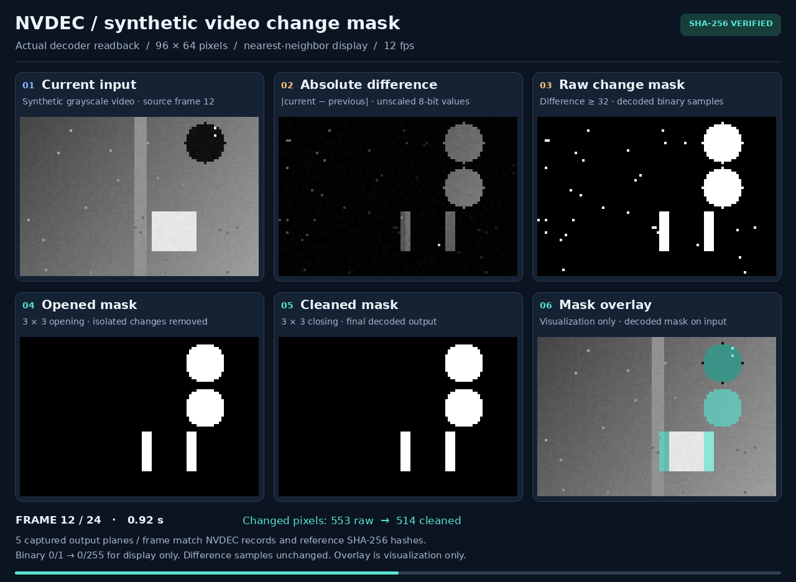

# Compiler optimizations

The compiler now emits direct Boolean predictions, shorter exact thresholds,
fused affine operations, grouped slices, and explicit retained references.
Recompiling the saved demonstrations preserves all **323 named output planes**
while removing **614 reference-copy pictures**.



| Workload | Previous pictures | Optimized pictures | Prediction slices, previous → optimized |
| --- | ---: | ---: | ---: |
| Life, 40 generations | 922 | **682** | 14,736 → 5,448 |
| Maze, 52 steps | 560 | **265** | 8,944 → 2,112 |
| Denoising, one image | 74 | **58** | 1,168 → 456 |
| MNIST, eight digits | 1,826 | **1,591** | 109,500 → 22,260 |
| Motion mask, one frame pair | 40 | **23** | 1,824 → 294 |

The complete comparison includes 42 cases: Life, maze, eight denoising images,
two eight-digit MNIST batches, six native-operation demos, and 24 motion pairs.
Together they use **6,753 → 5,187 pictures**, **297,924 → 63,260 prediction
slices**, and **6,738,862 → 2,892,706 stream bytes**. Prediction bytes alone fall
from 5,427,894 to 1,581,660. Input pictures still carry real PCM data.

## What changed

- Binary OR takes one weighted B prediction: `(a+b+1)>>1`. AND uses
  `clip8(a+b-1)`. OR/AND thresholds over disposable binary sums become gate
  chains, including duplicate elimination. Motion morphology drops from 32
  pictures to 16.
- A threshold can use `clip8(1-clip8(t-x))`, two exact P predictions. The
  compiler still prefers a one-picture solution when possible. Motion's
  cutoff of 32 saves one more picture.
- Commutative expressions share results; double negation disappears. Affine
  chains fuse only when intermediate clipping cannot occur and the final
  weights and offsets fit the codec. Named/shared intermediates remain observable.
- Long-term reference slots retain live pictures until their last use. Explicit
  marking replaces dead slots after prediction. This removes age-based refresh
  copies without increasing the 16-picture reference capacity.
- Consecutive macroblocks within a row share prediction slices when their
  headers agree. Motion differences account for the left neighbor. Guard
  regions remain zero, fractional reads retain their codec rounding, and
  intermediate crop boundaries remain intact.
- `program.costs` and JSON manifests expose input, normalization, arithmetic
  and copy pictures; prediction slices and bytes; peak live values; and slot
  assignments. Individual rewrite counters remain in `program.stats`.

## Verification

FFmpeg, OpenH264, VA-API and NVDEC match every byte of the optimized I420 pictures,
including guard and chroma. NVDEC verifies **5,187 pictures / 92,737,536 raw bytes**.
Every named output also matches the saved baseline
and an independent integer evaluation of its original graph. The saved graphs
and trained weights are unchanged; no output pixels are inserted into the
prediction instructions.

The local regression run covers 124 tests across the compiler, writer, runtime,
all five computational experiments and comparison preparation. It includes all
byte thresholds, exhaustive Boolean neighborhoods, clipping/cropping barriers,
reference-slot replacement and long-lived inputs. Full held-out neural accuracy
datasets were not rerun; the comparison uses the saved demo inputs and checks
their intermediate activations as well as predictions.

## Measured NVDEC performance

Each paired measurement uses the same inputs and decoder, one warmup per
variant and five repetitions. These single-job medians include full readback:

| Workload | Baseline | Optimized | Speedup |
| --- | ---: | ---: | ---: |
| Life, 40 generations | 2,203.05 ms | 1,305.62 ms | **1.69×** |
| Maze, 52 steps | 1,501.04 ms | 688.17 ms | **2.18×** |
| Denoising, one image | 443.33 ms | 367.55 ms | **1.21×** |
| MNIST, eight digits | 14,473.02 ms | 2,882.57 ms | **5.02×** |
| Motion, one frame pair | 465.74 ms | 321.68 ms | **1.45×** |

Native resident stages improve 1.36×; the tiny addition, affine, movement and
interpolation demos stay around 0.97–1.03× because startup dominates. Fewer
pictures or bytes do not guarantee lower latency. The separate local FFmpeg
measurements also show small workloads dominated by startup; those timings
are comparisons within FFmpeg, not comparisons between machines.

For the complete **24-pair motion batch**, separate five-repetition runs give:

| Mode | Baseline | Optimized | Speedup |
| --- | ---: | ---: | ---: |
| Restart per pair, all outputs | 11,947.25 ms | 7,820.01 ms | 1.53× |
| Restart per pair, final masks | 11,738.11 ms | 7,877.33 ms | 1.49× |
| One batch, all outputs | 5,066.20 ms | 1,203.89 ms | **4.21×** |
| One batch, final masks | 4,993.28 ms | 1,144.88 ms | **4.36×** |

The optimized final-mask batch yields **20.96 masks/s**, including stream
assembly, startup, decoding, readback and validation. These are fixed synthetic
96×64 inputs. The batch runs were consecutive (optimized, then baseline), with
mode order rotated inside each run; the single-job table alternates baseline
and optimized variants. No clock or power settings were changed.

The capture above comes from all 120 verified output planes of the optimized
motion run. Binary values are enlarged to 0/255 for display; differences retain
their byte values. All output pixels equal the original capture.

## Reproduce and inspect

From the repository root:

```sh
python3 05-h264-compiler/optimizations/prepare.py \
  --output 05-h264-compiler/optimizations/out/bundle
python3 05-h264-compiler/optimizations/benchmark.py \
  05-h264-compiler/optimizations/out/bundle --backend ffmpeg \
  --output 05-h264-compiler/optimizations/out/ffmpeg-timings.json
```

Preparation compiles each saved graph once and loads its original inputs into
the resulting reusable program. It always requires FFmpeg and additionally
checks available requested decoders. `--cases life maze denoise mnist native
motion` selects groups; `--local-backends ffmpeg` selects only software validation.

Copy the bundle and shared runtime to an NVDEC host. Build the
[NVDEC helper](../native_ops/nvdec/README.md#reproduce), then run:

```sh
python3 05-h264-compiler/native_ops/nvdec/run.py bundle \
  --helper decoder_core/.build/nvdec_decode --output results
python3 05-h264-compiler/optimizations/benchmark.py bundle \
  --helper decoder_core/.build/nvdec_decode --output nvdec-timings.json
```

The benchmark loads reference files before timing, warms both variants, then
rotates group order and alternates baseline/optimized order over five repetitions.
Every run checks all decoded bytes. Timings include startup, parsing, decoding,
full readback, file I/O, diagnostics and comparison; compilation, input packing
and network transfer are excluded. These are end-to-end measurements on small
images, not isolated arithmetic throughput or comparisons against GPU kernels.

[Comparison counts](assets/comparison.json), [suite and source hashes](assets/suite.json),
the [NVDEC correctness report](assets/nvdec-results.json),
[NVDEC paired timings](assets/nvdec-timings.json), and
[FFmpeg timing samples](assets/ffmpeg-timings.json) are saved alongside
[eleven executable optimized representatives](assets/streams/). Large raw
references and all 42 generated streams can be reproduced under ignored `out/`.
Historical assets remain in their experiment folders for baseline comparisons.
The 24-pair motion [baseline](assets/motion-baseline-timings.json) and
[optimized](assets/motion-optimized-timings.json) reports retain every sample;
the [optimized input bundle manifest](assets/motion-bundle.json) records their
input, output and source hashes.

To isolate backend changes, pass `reference_mode="sliding"` or
`slice_mode="macroblock"` to `h264.compile`. `optimize=False` disables lowering
optimizations and selects both legacy backend modes; it is a diagnostic control,
not the historical optimized-compiler baseline used in these measurements.
