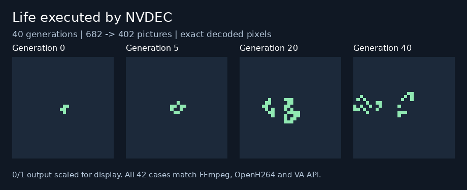

# Bounded exact instruction search

The compiler now searches for shorter prediction sequences for small scalar
subgraphs. It proves equivalence over every permitted input combination before
emitting H.264. Input pixels are still loaded separately, and the decoder
executes the resulting arithmetic.



[Animated NVDEC capture](assets/life.gif). These are decoded 0/1 pixels scaled
for display; the executable stream contains prediction instructions.

## Results against the previous optimized compiler

Both variants use the current compiler, grouped slices and retained references.
Only `exact_search=False` versus the default `True` changes.

| Workload | Pictures before → after | NVDEC median before → after |
| --- | ---: | ---: |
| Life, 40 generations | **682 → 402** | **1,283.82 → 834.24 ms** |
| Denoising, one image | **58 → 52** | 361.11 → 350.75 ms |
| MNIST, eight digits | 1,591 → 1,589 | 2,716.17 → 2,876.02 ms |
| Maze, 52 steps | 265 → 265 | 640.34 → 733.15 ms |
| Motion, one pair | 23 → 23 | 314.72 → 321.42 ms |

Life uses **41.1% fewer pictures** and runs **1.54× faster** in this measurement.
Denoising removes six predictions; MNIST removes only two. The timing samples
do not establish a speedup for either neural workload. Maze, motion and all six
native-operation demos produce byte-identical before/after streams; their timing
differences show runtime variability, not compiler regressions or improvements.

Measurements use one warmup per variant and five repetitions, alternating
variant order and rotating workload order. They include startup, parsing,
decoding, full readback, file I/O and exact byte comparison. Compilation, input
packing and network transfer are excluded. Fixed startup and measurement noise
matter for these small images; no isolated decoder-throughput claim is made.

## How it works

The generic search found this three-picture Life rule, where `n` is the neighbor
count and `c` is the current binary cell:

```text
u    = clip8(2*n + c - 4)
v    = clip8(2*n + c - 6)
next = clip8((u - 2*v + 1) >> 1)
```

The first two B predictions use weights `(4,2)`, offsets `-4` and `-6`, and
denominator zero. The final B prediction uses weights `(1,-2)`, zero offsets,
and denominator zero. All 18 combinations of `n=0..8` and `c=0..1` produce
exactly Conway's rule. Seven neighbor-sum pictures plus three rule pictures
replace seventeen pictures per generation: `2 + 40*10 = 402` including seed
and normalization.

There is no Life-specific rewrite. Search also merges some neural threshold
and arithmetic operations. Its finite grammar explores up to three predictions,
one or two scalar inputs, and at most 64 Cartesian input combinations. Graph
cuts have at most 32 internal nodes, with 24 candidate cuts retained per node.
Named/shared outputs and movement boundaries remain intact. Shorter candidates
must pass exhaustive signed-integer rounding/clipping checks, and a whole-graph
instruction-count check prevents losing more existing fusion than is gained.
Unsupported cases retain existing lowering. This is not a globally optimal
instruction search; [DESIGN.md](../../DESIGN.md#bounded-exact-instruction-search)
and [synthesize.py](../../h264/synthesize.py) document its bounded grammar.

## Validation and reproduction

**148 tests pass**, including all 512 Life neighborhoods, random edge-touching
boards over 40 generations, generic predicates, independent manifest-proof
replay, clipping/movement boundaries and fallback behavior. All **42 saved
cases / 323 named planes** agree with historical outputs and an independent
graph interpreter. FFmpeg, OpenH264, VA-API and NVDEC agree on every byte of the
**4,855 pictures / 90,630,144 I420 bytes**, including guard and chroma. Full neural
accuracy datasets were not rerun; frozen models and saved demo inputs are unchanged.

From the repository root:

```sh
python3 05-h264-compiler/optimizations/prepare.py \
  --baseline no-exact-search \
  --output 05-h264-compiler/optimizations/out/exact-search-bundle
```

Copy the bundle and [NVDEC runtime](../../native_ops/nvdec/README.md#reproduce)
to the decoder host, then run there:

```sh
python3 05-h264-compiler/native_ops/nvdec/run.py exact-search-bundle \
  --helper decoder_core/.build/nvdec_decode --output exact-search-results
python3 05-h264-compiler/optimizations/benchmark.py exact-search-bundle \
  --helper decoder_core/.build/nvdec_decode --output nvdec-timings.json
```

After copying results back, `capture.py BUNDLE RESULTS --output assets` renders
the checked Life planes using Pillow. The full regenerated bundle stays under
ignored `out/`. Published artifacts include [counts](assets/comparison.json),
[suite and source hashes](assets/suite.json), [NVDEC validation](assets/nvdec-results.json),
[every timing sample](assets/nvdec-timings.json), and
[three changed executable representatives](assets/streams/). Their JSON manifests
contain each rewrite's truth table, input ranges and legal prediction sequence.
