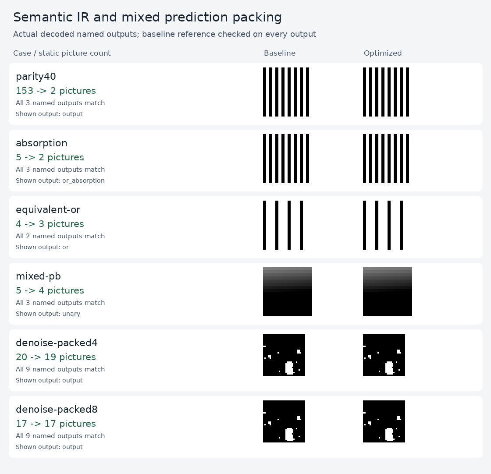

# Semantic IR and mixed prediction packing

These improvements operate inside the shared compiler. They remove redundant
Boolean work before instruction selection and pack compatible P/B operations
into the same picture. Both are enabled by default.



The capture shows actual FFmpeg output pixels. Binary images are enlarged and
mapped from 0/1 to black/white; byte images retain their values. The input pixels
and every named result agree between variants.

## Measured compiler costs

Counts include input pictures and any normalization. These are static decoder
work counts, not measured latency improvements.

| Program | Before | After |
| --- | ---: | ---: |
| Forty XOR rounds with fixed second input | 153 | **2** |
| Two absorption identities | 5 | **2** |
| OR and equivalent De Morgan output | 4 | **3** |
| Mixed P/B arithmetic | 5 | **4** |
| Frozen denoiser, four tiles | 20 | **19** |
| Frozen denoiser, eight tiles | 17 | 17 |
| Life, 40 generations | 402 | 402 |
| Current maze flood fill | 214 | 214 |
| Unpacked denoiser | 52 | 52 |
| MNIST, eight digits | 1,589 | 1,589 |
| Motion mask | 23 | 23 |

The forty-round XOR program returns its original first input, so it needs no
arithmetic pictures. This is compile-time elimination of redundant work; it is
not a claim of executing 40 useful rounds faster. Named intermediate outputs
remain observable and are retained when requested.

At four tiles, the denoiser keeps the same 112×112 coded geometry and frozen
weights. Its prediction slices fall from **337 to 330**, prediction bytes from
**8,056 to 7,949**, and total coded luma samples from **250,880 to 238,336**.
Eight tiles already fit these dependencies into 17 pictures and remain unchanged.

## How it works

[ir.py](../../h264/ir.py) gives scalar expressions complete truth signatures
over at most two binary frontier values. Four entries suffice, even when the
intermediate arithmetic is nonbinary. Bottom-up propagation recognizes input
aliases, constants, absorption, and equivalent expressions across long graphs.
Movement and wider expressions form boundaries, preserving crop and clipping
semantics. No actual input pixels enter compilation.

Sharing can interfere with later fusion. A whole-graph comparison keeps the
previous instruction plan if a rewrite would increase scalar instruction count.
When discarded arithmetic cannot be represented, a legal simplified program may
still compile; its baseline saving is unknown. This guard does not optimize all
picture, byte, or reference costs jointly. `reference()` and `verify()` retain
the original traced graph independently of the rewritten IR.

[packed.py](../../h264/packed.py) groups ready P and B operations. A rounded P
prediction with denominator `d>0` becomes B with weights `(w,0)` at `d-1` and
equal offsets. At `d=0`, duplicate operands with weights `(w,w)` are exact when
the combined weight is legal. Other unary predictions keep a P picture.
These transformations preserve rounding, clipping, motion, and offsets; they
never read another result from the same unfinished picture.

The writer and synthesis now also enforce H.264's combined B-weight limit.
Affine fusion keeps separate legal stages when their combined coefficients
would exceed it. That check prompted a [correction to experiment 08's enumeration](../../../08-decoder-compute-limits/CERTIFICATE-CORRECTION.md);
all saved atlas witnesses and minima remain unchanged.

## Validation and reproduction

[comparison.json](assets/comparison.json) records **57 comparisons, 114 streams,
519 named outputs, and 1,280,768 logical output pixels per variant**. FFmpeg,
OpenH264, and VA-API match every named result and full I420 byte stream. Saved
Life, both maze formulations, denoising, MNIST, and motion inputs are reused;
their historical decoded outputs provide an additional independent check.
Source hashes, individual costs, and decoder status are recorded. No model is
retrained and no datasets are downloaded.

[NVDEC validation](assets/nvdec-validation.json) also passes all **24 representative
streams, 5,341 pictures, and 88,091,520 I420 bytes**. Its
[suite index](assets/nvdec-suite.json) identifies the exact baseline/optimized
pairs and hashes. This hardware run covers the first saved segment per graph;
the 114-stream comparison above covers every local saved segment.

Final compiler, shared decoder, and experiment-08 suites pass **186 tests**.
Additional deterministic DAG checks exercised clipping, wider input domains,
zero coefficients, movement, named outputs, and savings accounting. A regression
injects an intentionally incorrect IR rewrite and confirms that verification
against the original graph detects it.

From the repository root:

```sh
python3 -m unittest discover -s 05-h264-compiler -v
python3 05-h264-compiler/optimizations/ir/compare.py
python3 05-h264-compiler/optimizations/ir/capture.py \
  05-h264-compiler/optimizations/ir/out/bundle \
  --output 05-h264-compiler/optimizations/ir/assets/comparison.png
```

Use `compile(..., semantic_ir=False)` to disable value propagation. Use
`pack(..., mixed_predictions=False)` to disable mixed grouping. This comparison
pins `scheduling="stable"` in both packing variants to isolate these changes
from the later [schedule selection pass](../packing/README.md). `exact_search`
remains an independent option; `optimize=False` disables semantic IR too.
Manifests record rewrite counts, truth signatures, savings, P-to-B promotions,
mixed-picture counts, output rectangles, and actual instructions.

For portable NVDEC validation, `compact.py` exports the first baseline/optimized
pair per graph. Copy that bundle, `validate.py`, and `decoder_core/decode.py` to
an NVDEC environment with the existing helper, then run:

```sh
python3 05-h264-compiler/optimizations/ir/compact.py \
  05-h264-compiler/optimizations/ir/out/bundle \
  --output 05-h264-compiler/optimizations/ir/out/representatives
python3 05-h264-compiler/optimizations/ir/validate.py \
  05-h264-compiler/optimizations/ir/out/representatives \
  --backend nvdec --helper decoder_core/.build/nvdec_decode \
  --output 05-h264-compiler/optimizations/ir/out/nvdec-validation.json
```
