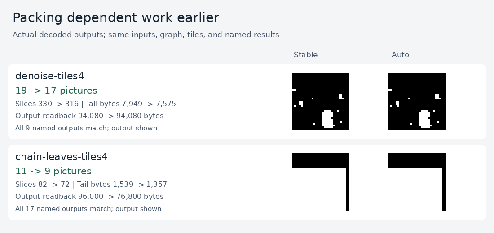

# Packing schedule comparison

Automatic packing reduces the frozen denoiser from **19 to 17 pictures at four
tiles**, preserving its inputs, weights, graph, and all nine named outputs.
The coded geometry stays 112×112. Prediction slices fall from **330 to 316**,
prediction bytes from **7,949 to 7,575**, and full I420 readback from **357,504 to
319,872 bytes**. Named-output picture readback stays **94,080 bytes**.

These are exact static stream costs. Decoder latency was not measured.



The capture extracts actual named output regions from checked FFmpeg I420
bytes. Binary values are displayed as black and white; other values retain
their byte intensities. Both displayed images also match the independent graph
reference.

## Stable versus automatic scheduling

`h264.pack(program, tiles=4, scheduling="stable")` preserves the previous FIFO
order among ready operations. `scheduling="critical"` prioritizes ready work
with the longest remaining dependency path, breaking ties by original frame
number. Both preserve dependencies and legal mixed P/B prediction grouping.

The default, `scheduling="auto"`, compares legal candidates and accepts a new
schedule only when pictures, prediction slices, prediction bytes, and
named-output readback bytes all avoid regression. Manifests record both
candidate costs and the selected schedule.

| Graph | Tiles | Stable pictures | Auto pictures |
| --- | ---: | ---: | ---: |
| Frozen denoiser | 2 | 29 | 29 |
| Frozen denoiser | 3 | 21 | 21 |
| Frozen denoiser | 4 | 19 | **17** |
| Frozen denoiser | 8 | 17 | 17 |
| Life, 40 generations | 2 / 4 | 362 / 362 | 362 / 362 |
| Current maze flood | 2 / 4 | 211 / 211 | 211 / 211 |
| Eight independent leaves and eight named chain stages | 2 / 3 / 4 / 8 | 13 / 11 / 11 / 10 | **9 / 9 / 9 / 9** |

The denoiser's rejected candidates explain why fewer pictures alone are
insufficient. At two tiles, critical scheduling saves one picture but adds one
prediction byte. At three tiles, it saves one picture but increases output
readback from 76,800 to 122,880 bytes. At eight tiles, it adds six prediction
bytes. Automatic scheduling retains stable order in all three cases.

## Evidence and scope

[comparison.json](assets/comparison.json) records **40 comparisons and 80
streams**, covering **550 named outputs and 510,976 logical output pixels per
variant**. FFmpeg, OpenH264, and VA-API match all named outputs and all full I420
bytes. Every comparison also checks the four static cost guard metrics.
The main compiler suite passes 119 tests; both packing-harness cost guard
regressions pass as well.

All eight committed denoising inputs run at 2, 3, 4, and 8 tiles. Committed Life
and the current maze formulation run at 2 and 4 tiles. Their named results
match both the old compiler graph reference and historical decoded outputs.
The synthetic 16×16 case contains every u8 input value, retains every chain
stage as a named output, and runs at 2, 3, 4, and 8 tiles. Its reference evaluates
the original graph independently of packing.

Separate construction probes are excluded from decoded validation counts.
MNIST at 2/4 tiles exceeds the packer's 16-pixel motion halo. Motion at four
tiles exceeds the initial PCM access-unit size bound. Motion at two tiles is
constructible and is recorded as **not decoded** in this comparison.

Source and historical-input hashes, decoder status, candidate costs, and stream
hashes are preserved in the report. The curated denoiser streams and manifests
contain the first saved input; the reproducible bundle contains every input.
No model is retrained and no dataset is downloaded.

## Reproduction

From the repository root:

```sh
python3 -m unittest discover -s 05-h264-compiler/optimizations/packing -v
python3 05-h264-compiler/optimizations/packing/compare.py
python3 05-h264-compiler/optimizations/packing/capture.py \
  05-h264-compiler/optimizations/packing/out/bundle \
  --output 05-h264-compiler/optimizations/packing/assets/comparison.png
```

`--cases denoise`, `--local-backends ffmpeg`, and `--output PATH` support smaller
runs. Default validation uses every available FFmpeg/OpenH264/VA-API backend.
Unavailable requested backends are recorded explicitly. FFmpeg is required.
Generated bundles live under ignored `out/` directories.

The harness reuses the [saved graph and decoder adapters](../ir/compare.py).
The existing portable validator reads packed output regions correctly, and the
compactor exports the first stable/auto pair per graph and tile capacity:

```sh
python3 05-h264-compiler/optimizations/ir/compact.py \
  05-h264-compiler/optimizations/packing/out/bundle \
  --output 05-h264-compiler/optimizations/packing/out/representatives
python3 05-h264-compiler/optimizations/ir/validate.py \
  05-h264-compiler/optimizations/packing/out/representatives \
  --backend nvdec --helper decoder_core/.build/nvdec_decode \
  --output 05-h264-compiler/optimizations/packing/out/nvdec-validation.json
```

The portable validator needs the prepared bundle, `ir/validate.py`,
`decoder_core/decode.py`, and the decoder helper; it does not compile graphs or
load demo fixtures.
