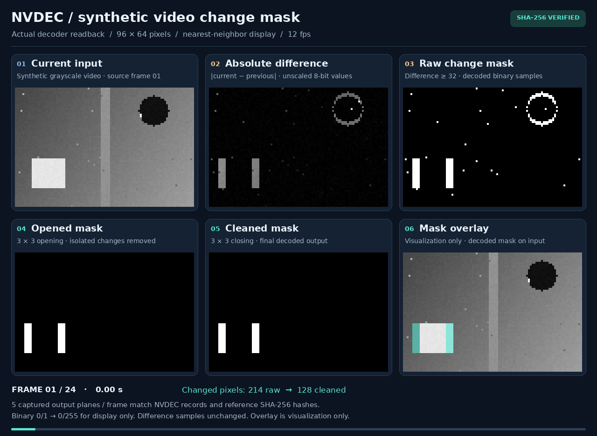

# 06 — Motion masks inside an H.264 decoder

The decoder computes absolute differences between grayscale frames, thresholds
them, and cleans the binary masks with 3 × 3 opening followed by closing.
The [optimized compiler](../05-h264-compiler/optimizations/README.md) now uses
**23 pictures per pair**, down from 40, with identical output masks.

The original saved capture below uses the 40-picture baseline.
**All 24 frame pairs / 960 baseline pictures matched exactly on NVDEC**,
FFmpeg, Intel VA-API, and OpenH264. The NVDEC run checked 17,694,720 raw bytes
and 120 named output planes.



[MP4 capture](assets/motion-capture.mp4) · [Still capture](assets/motion-capture.png)
· [Executable H.264](assets/motion.h264) · [Instruction manifest](assets/program.json)

The preview plays at 12 fps for presentation; this is not measured throughput.
It uses synthetic moving shapes, mild intensity noise, and isolated impulses.
Panels show actual NVDEC outputs. Binary 0/1 is enlarged to black/white for
display; the colored overlay is presentation only.

## How it works

```text
previous + current → absolute difference → threshold ≥ 32
                   → 3×3 opening → 3×3 closing → binary change mask
```

[kernel.py](kernel.py) expresses everything through the shared Python compiler:

- Two signed, clipped subtractions and their sum give exact `abs(current-previous)`.
- Thresholding produces 0/1 samples.
- Opening erodes then dilates, removing isolated changes.
- Closing dilates then erodes, filling small holes and gaps.

Each newly compiled pair uses **two PCM input pictures and 21 prediction pictures**. The same
prediction bytes are reused for every pair. CPU work supplies inputs and writes
instructions; the decoder computes the differences and morphology. The separate
[pixel oracle](reference.py) and graph interpreter run only for verification.

These are **changed pixels**, not complete object segmentation. Both old and
new object edges can appear. Cleanup also removes narrow real changes. Fixed
zero padding affects image borders, and camera motion or lighting changes can
trigger broad masks. The demo is 96 × 64 active pixels inside 128 × 96 coded
pictures, with a 16-pixel guard.

## Persistent batches and selective readback

`decoder_core.decode.decode_batch()` concatenates independent jobs into **one
decoder session**, with an IDR reset between jobs. On NVDEC, intermediate
output samples are released without VIC copies or CPU pixel readback; internal
reference pictures remain available to decoding. Only requested frames are
copied, preserving full-range values. This is a finite batch ending at EOS,
not an online service. Both input pictures are still loaded for each pair.

```python
from decoder_core.decode import decode_batch

result = decode_batch(
    paths, backend="nvdec", width=128, height=96,
    pictures_per_job=23, selected_frames=(22,),
)
final_i420 = result.frames[0][0]  # First job, final picture; includes guard/chroma.
```

Original baseline NVDEC medians, five repetitions after warmup, for 24 frame pairs:

| Execution | Pictures copied | Total time |
| --- | ---: | ---: |
| Restart per pair, copy everything | 960 | 11.806 s |
| Restart per pair, copy final masks | 24 | 11.701 s |
| One batch, copy everything | 960 | 4.911 s |
| One batch, copy final masks | 24 | 4.987 s |

Batching improved this workload by about **2.4×**. Selective readback reduced
copied bytes by **97.5%**, from 17,694,720 to 442,368, but gave no measured speedup
here. The final-mask batch produces about **4.8 masks/s**, including startup,
stream assembly, decoding, readback, and correctness checks. Compilation and
input packing are excluded. These are small-workload measurements, not isolated
NVDEC throughput. See [validation and full samples](VALIDATION.md).
The [optimization report](../05-h264-compiler/optimizations/README.md) includes
fresh baseline and optimized measurements, plus the smaller executable streams.

## Reproduce

From the repository root, with Python 3.10+, Pillow, FFmpeg, and optional local
GStreamer decoders:

```sh
python3 06-motion-mask-decoder/prepare.py
python3 -m unittest discover -s 06-motion-mask-decoder -v
python3 -m unittest decoder_core.test_decode -v
python3 06-motion-mask-decoder/benchmark.py 06-motion-mask-decoder/out/bundle \
  --backend ffmpeg --output 06-motion-mask-decoder/out/ffmpeg-results --repeats 3
```

Copy `out/bundle`, `benchmark.py`, and the shared `decoder_core` helper sources
to an NVDEC environment. Use the [build instructions](../05-h264-compiler/native_ops/nvdec/README.md#reproduce).
The target runner needs only Python 3.8 and the built helper:

```sh
python3 benchmark.py bundle --helper decoder_core/.build/nvdec_decode \
  --output results --repeats 5
```

Copy `results` back to `06-motion-mask-decoder/out/nvdec-results`, then run
`python3 06-motion-mask-decoder/capture.py`. Raw references and PGMs stay under
ignored `out/`; committed captures verify their hashes against the reports.
