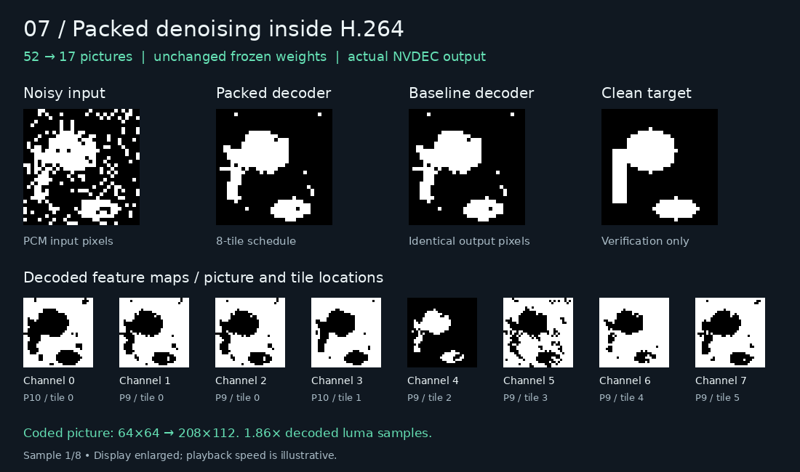

# 07 — Packed denoising inside H.264

Independent neural calculations share tiles in the same decoded pictures.
The unchanged denoiser now needs **17 pictures instead of 52** and runs
**1.68× faster on NVDEC** in the eight-image benchmark below. Every output
pixel and feature map remains identical.



[MP4](assets/packed-capture.mp4) · [Still](assets/packed-capture.png) ·
[Executable H.264](assets/packed.h264) · [Instruction manifest](assets/program.json)

The capture enlarges actual decoded 0/1 outputs. Playback speed is illustrative.
The clean target is shown for comparison; it never enters the decoder.

## How it works

[kernel.py](kernel.py) compiles the existing frozen `1→8` binary 3×3 convolution
and `8→1` mixing layer from [experiment 03](../03-denoising-decoder/README.md).
There is no retraining. The new shared `h264.pack(program, tiles=8)` pass groups
ready, independent P or B predictions into one picture, with one intermediate
logical image per tile. Tile assignments can change between pictures.

Per-block prediction headers supply each tile's weights and offsets. Motion
vectors read the appropriate tile in earlier reference pictures. Sixteen-pixel
zero gaps preserve the original boundary behavior. The scheduler retains whole
pictures until their last use; the manifest maps every original instruction
and named output to its new picture and tile.

The host supplies one noisy PCM input and the cached prediction instructions.
All convolution, threshold, and mixing arithmetic occurs during decoding.
Python and PyTorch inference run separately for verification only.

## Measured tradeoff

NVDEC medians from five repetitions after warmup; each batch contains the same
eight 32×32 images in one decoder session. Readback includes every named feature
and final output, with aliases sharing a physical picture.

| Schedule | Pictures/image | Coded dimensions | Luma samples/image | Batch time |
| --- | ---: | ---: | ---: | ---: |
| Baseline | 52 | 64×64 | 212,992 | 920.67 ms |
| 2 tiles | 29 | 112×64 | 207,872 | 695.14 ms |
| 4 tiles | 20 | 112×112 | 250,880 | 573.74 ms |
| 8 tiles | **17** | 208×112 | 396,032 | **548.60 ms** |

Timing includes batch assembly, startup, decoding, readback, and output equality
checks. Compilation and PCM input packing are excluded. Eight tiles process
**1.86× more luma samples** and copy **2.13× more output bytes** than the baseline.
The first input grows from 7,979 to 46,530 bytes; prediction instructions shrink
from 9,080 to 8,285 bytes. This small workload benefits despite those costs.
These timings do not establish a GPU-compute speed advantage or larger-image
performance. Full-readback timing and individual samples are in
[validation](VALIDATION.md) and the [raw report](assets/nvdec-results.json).

The compiler's newer [mixed prediction packing](../05-h264-compiler/optimizations/ir/README.md)
reduces the four-tile version to **19 pictures** by sharing compatible P and B
operations. The eight-tile version remains at 17. The table above preserves
the original measured schedules; its timings do not measure this newer pass.
The later [shared scheduling pass](../05-h264-compiler/optimizations/packing/README.md)
reaches **17 pictures with four tiles** too, using the same 112×112 canvas and
preserving every feature output. The table's timings also predate this pass.

Packing currently supports uniform integer reads within ±16 pixels and rejects
fractional motion, block gathers, and layouts exceeding writer limits. It is an
explicit option; existing programs keep their current schedules by default.

## Reproduce

From the repository root, with Python 3.10+, FFmpeg, and Pillow for captures:

```sh
python3 07-packed-denoising-decoder/prepare.py
python3 -m unittest discover -s 07-packed-denoising-decoder -v
python3 07-packed-denoising-decoder/benchmark.py \
  --bundle 07-packed-denoising-decoder/out/bundle \
  --backend ffmpeg --repeats 5 --output 07-packed-denoising-decoder/out/ffmpeg-results
```

Copy the bundle, `benchmark.py`, and `decoder_core/decode.py` to an NVDEC
environment with the [built helper](../05-h264-compiler/native_ops/nvdec/README.md#reproduce).
The runner needs only Python 3.8 and the standard library; no compiler or model:

```sh
python3 07-packed-denoising-decoder/benchmark.py \
  --bundle 07-packed-denoising-decoder/out/bundle --backend nvdec --repeats 5 \
  --helper decoder_core/.build/nvdec_decode \
  --output 07-packed-denoising-decoder/out/nvdec-results
```

Copy the results back, then run `python3 07-packed-denoising-decoder/capture.py`.
It checks captured pixel hashes before rendering. All generated raw data stays
under ignored `out/`; committed assets contain the measured capture and reports.
