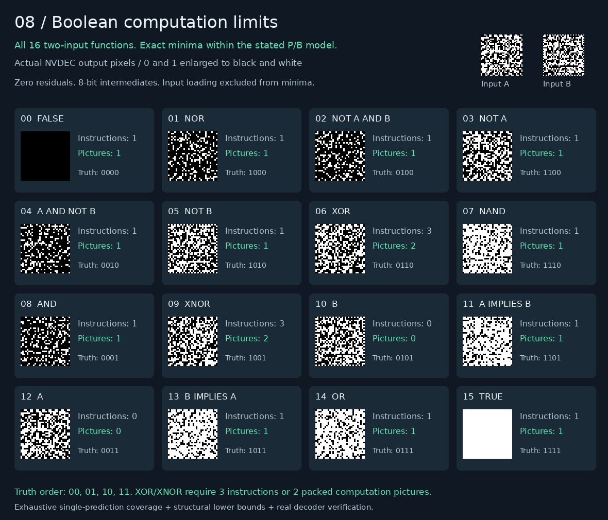

# 08 — Limits and costs of decoder computation

All **16 two-input Boolean functions** now have exact minimum instruction and
picture counts under a stated weighted-prediction model. The same constructions
run exactly on FFmpeg, OpenH264, VA-API, and NVDEC. This experiment also measures
execution costs, compares alternative schedules, and tests useful denoising
alongside a CUDA workload.

NVDEC inference preserves about **98–100%** of background GPU throughput here,
but the equivalent CUDA denoiser completes hundreds of times faster. The test
establishes overlap without demonstrating a useful offload advantage.



Actual decoded 0/1 pixels, enlarged and mapped to black/white. Each card uses
the same two inputs. [Atlas and certificate](assets/atlas.json) ·
[Executable XOR](assets/xor.h264) · [XOR manifest](assets/xor.json) ·
[Executable XNOR](assets/xnor.h264) · [XNOR manifest](assets/xnor.json).

## Exact Boolean results

| Function group | Scalar P/B instructions | Packed computation pictures |
| --- | ---: | ---: |
| Input aliases A, B | 0 | 0 |
| Other 12 functions, including constants | 1 | 1 |
| XOR, XNOR | **3** | **2** |

Inputs are already-resident literal 0/1 values. Each operation is a legal
8-bit weighted P or B prediction with exact rounding and clipping, zero
residual, and no deblocking. Intermediates may use every value from 0 to 255.
Independent operations can occupy different tiles in one picture; all reads
come from earlier pictures. Input loading and readback are outside the minima.
The executable examples additionally load two PCM input pictures.

[atlas.py](atlas.py) exhausts **536,560 reduced single-prediction classes**, with
proved reductions covering all legal weights, denominators, source choices,
and offsets. Only XOR and XNOR cannot be expressed by one prediction.
A separate monotonicity argument rules out every two-instruction parity
construction, including those using nonbinary intermediates.
The complete model, reductions, witnesses, and lower bounds are in
[PROOFS.md](PROOFS.md). These are bounds for this instruction model, not every
mechanism available in H.264.

For example, XOR computes `u = clip(A-B)` and `v = clip(B-A)` independently,
then `u+v`. Two tiles execute the first two operations in one picture, followed
by one combining picture. The saved streams directly emit these witnesses
through the shared writer, preserving their instruction counts.

## What performance means here

At 32×32, a 128-round XOR recurrence took **854.88 ms scalar** and
**643.78 ms packed** on NVDEC: a **1.33×** improvement. Packing reduced total
pictures from 386 to 258 while increasing processed luma samples. These are
medians of five runs, including startup, stream submission, decoding, and
final-picture readback. They exclude compilation and input packing.

Repeated Boolean updates are execution microbenchmarks: many rounds can
simplify algebraically, so their update rates are **not useful-computation
TOPS**. [Measured costs and validation](VALIDATION.md) separate logical updates,
decoded samples, pictures, input bytes, and readback. The largest tested board
is only 64×64; this does not measure peak decoder throughput.

[Joint synthesis and scheduling](SCHEDULING.md) compares equally minimal
three-instruction parity constructions with different dependency depths and
tile costs. [Concurrent GPU execution](CONCURRENCY.md) uses the real frozen
denoiser and an exact CUDA implementation, with fixed compute and memory
workloads. It reports completion time for both jobs and GPU work rate.

## Reproduce

From the repository root, with Python 3.10+, FFmpeg, and optional OpenH264 and
VA-API backends:

```sh
python3 08-decoder-compute-limits/atlas.py --output /tmp/boolean-atlas.json
python3 08-decoder-compute-limits/atlas.py --verify /tmp/boolean-atlas.json
python3 08-decoder-compute-limits/prepare.py
python3 08-decoder-compute-limits/joint.py
python3 -m unittest discover -s 08-decoder-compute-limits -v
```

`prepare.py` freezes 44 streams, full I420 references, independent truth-table
outputs, input pixels, prediction tails, manifests, proofs, and source hashes
under ignored `out/bundle/`. Available software/hardware backends compare every
decoded byte. `joint.py` produces a separate six-case bundle under `out/joint/`.

Copy a bundle, `benchmark.py`, and `decoder_core/decode.py` to an NVDEC
environment with the [built helper](../05-h264-compiler/native_ops/nvdec/README.md#reproduce).
The portable runner needs only Python 3.8 and the standard library:

```sh
python3 08-decoder-compute-limits/benchmark.py \
  --bundle 08-decoder-compute-limits/out/bundle --backend nvdec --repeats 5 \
  --helper decoder_core/.build/nvdec_decode \
  --output 08-decoder-compute-limits/out/nvdec-results
```

Use `--backend ffmpeg` locally. Copy NVDEC results back, then run
`python3 08-decoder-compute-limits/capture.py` to render the hash-checked capture.
CUDA build and concurrency commands are in [CONCURRENCY.md](CONCURRENCY.md).
The source emitter is experimental; these results do not silently change
existing compiler lowering or introduce a general joint optimizer.
