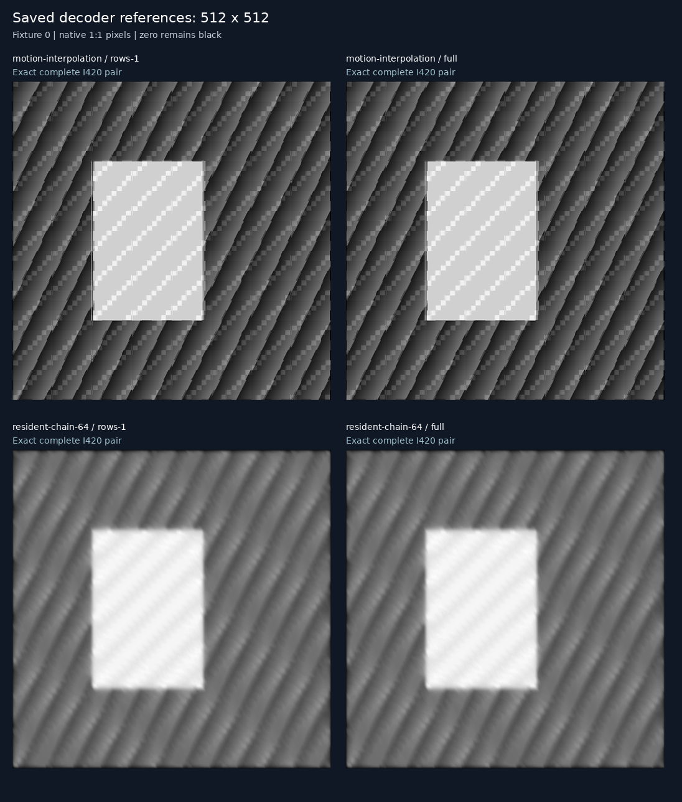

# 10 — Decoder interface limits

This experiment tests where decoder computation could save useful resources,
and which interface change might remove a measured bottleneck. It uses the
[experiment 09 shared IR](../09-codec-compute-ir/README.md), with an opt-in H.264
target improvement that groups compatible prediction rows into larger slices.
The [predeclared plan](PLAN.md) fixes the workloads, interfaces and decision rules.

**Result: fewer slices substantially improve latency, but no tested workload
beats native CPU elapsed time.** The 64-stage synthetic chain uses **41.9% less
process CPU** while taking **18.3% longer**. Patch routing and one-step motion
interpolation remain poor standalone offloads. Omitting host input preparation
and output readback does not reverse that conclusion on this runtime.

## Measurements

Warm median milliseconds per request, five repeats of four changing inputs.
NVDEC columns include fresh host inputs, native PCM serialization, selected
host output and exact checks. Raw samples and lifecycle costs are preserved in
[results.json](assets/results.json).

| Workload | Native CPU | NVDEC: one row | NVDEC: four rows | NVDEC: whole picture |
| --- | ---: | ---: | ---: | ---: |
| Copy control | 0.132 | 12.639 | 12.773 | 13.158 |
| Patch atlas | 0.172 | 14.186 | 13.385 | 13.114 |
| Motion interpolation | 2.137 | 28.978 | 26.855 | 25.338 |
| 8-stage recurrence | 10.433 | 53.415 | 32.832 | 32.047 |
| 32-stage recurrence | 41.066 | 117.034 | 61.947 | 57.900 |
| 64-stage recurrence | 81.863 | 216.274 | 97.706 | 96.822 |

Whole-picture slices reduce 64-stage latency **55.2%** relative to one-row
slices. Most of the improvement already appears with four rows; four-row and
whole-picture trial ranges overlap, so this is not proof that one slice is
always optimal. Whole-picture 64-stage elapsed times range **94.12–116.36 ms**,
versus CPU **81.77–88.10 ms**. The CPU remains faster across those trial ranges.

The resource tradeoff is more promising: whole-picture 64-stage process CPU is
**47.48 ms** per job (44.01–49.08), versus CPU **81.71 ms** (81.63–81.93).
At 32 stages it is **27.11 versus 40.98 ms**, a 33.8% reduction, also with
separated ranges. This is evidence for latency-tolerant CPU offload of long
resident chains. The recurrence is synthetic; it does not establish a useful
vision task, improved concurrent GPU work, or energy savings.

### Interface sensitivity

These whole-picture timings deliberately have different work/result contracts:

| Workload | Fresh host input/output | Prepared input, host output | Prepared input, completion only |
| --- | ---: | ---: | ---: |
| Copy control | 13.158 | 12.323 | 8.351 |
| Patch atlas | 13.114 | 11.955 | 9.384 |
| Motion interpolation | 25.338 | 24.134 | 14.023 |
| 8-stage recurrence | 32.047 | 30.307 | 21.528 |
| 32-stage recurrence | 57.900 | 51.741 | 53.915 |
| 64-stage recurrence | 96.822 | 112.043 | 113.996 |

Even completion-only loses to CPU elapsed time at every workload. It still
submits and decodes input pictures, waits for real outputs and submits fences;
it does not simulate imported references. The practical single-stage cases
therefore have no demonstrated niche from removing readback alone. Some
omitted-work medians are slower, and outliers remain in the raw data. Separate
trials overlap and include scheduling variability: do not subtract these
medians to estimate isolated serialization or readback costs. The copy control
also differs in input content/count from the other tasks, so it is context,
not an exact additive decomposition of their overhead.

## What to pursue

1. **Software first:** keep the slice-band optimization available and test a
   real long, stateful workload that can trade latency for CPU availability.
   This experiment supports that resource tradeoff, not a general speed claim.
2. **Prototype explicit reference surfaces and completion:** start from
   already-decoded inputs, run the supplied-motion resample/blend, and let an
   actual consumer use its result without host readback or a reset fence.
   This targets work the completion-only diagnostic still performs. Input
   import and retained-state completion are unimplemented and unmeasured here.
3. **Only then propose hardware changes:** a narrow command interface for
   source/destination surfaces, block vectors, weights and completion is a
   concrete research target. Driver/firmware support might suffice for parts
   of it; silicon area, power and implementation effort are unknown.

The [interface analysis](INTERFACES.md) compares those candidates with existing
documented APIs. The installed NVDECODE library path lacks the documented
direct-array API; alternative buffer-interop routes have not been tested here.
A different stack, genuinely resident inputs, a
useful longer computation, or a different decoder could change the conclusion;
none is a demonstrated performance win. Today's null result is scoped to these
standalone primitives and this measured interface, not all decoder computation.

## What changed

`h264_prediction_slice_rows=1` preserves the existing row layout; `4` groups
four coded macroblock rows; `0` uses a whole-picture slice when headers are
compatible. The backend now calculates the actual cross-row motion-vector
predictor. It falls back to the previous layout for incompatible operations.
This changes instruction delivery, not requested image arithmetic. The default
remains one row, because arbitrary fields can change motion-vector coding costs.

At 512×512 active pixels, compatible predictions have 34, 9 or 1 slices per
picture respectively. The 64-stage recurrence falls from 2,176 to 64 prediction
slices and from 151,616 to 111,936 prediction bytes. Inputs, guards, picture
count, reference dependencies and every decoded I420 sample remain identical.

The persistent NVDEC worker also advertises protocol v2 and accepts an explicit
completion-only request. Ordinary output requests remain supported. New clients
can use older v1 workers for ordinary requests; completion-only requires v2.
An older v1-only client rejects a v2 worker, so keep historical worker/client
pairs together. Completion-only waits for every real picture, copies no results,
and exposes no consumer surface.

## Comparison contract

Six workloads use 512×512 active luma: a copy control, patch routing,
externally supplied-motion interpolation, and synthetic 8/32/64-stage
fractional-resampling recurrences. Four changing fixtures cover scene, noise,
all-zero and all-255 inputs. Five rotated repeats measure four requests each.
Motion estimation is outside every implementation.

| Mode | Timed input work | Timed result |
| --- | --- | --- |
| CPU | Compact host input; native/unrolled `-O3` C++ | Compact luma bytes and exact check |
| `native-host` | Native PCM serialization, prefix check, input decode and prediction | Selected complete I420 readback and exact check |
| `prepared-host` | Prepared compressed inputs still submitted and decoded, then prediction | Selected complete I420 readback and exact check |
| `prepared-complete` | Prepared compressed inputs still submitted and decoded, then prediction | Completion only; zero copied frames, no consumer |

Only `native-host` includes fresh host inputs and a complete host result. The
other modes deliberately omit work. Completion-only is an unequal-interface
diagnostic, not an application benchmark or an implementation of input-surface
import. CPU chains use the stronger shared-plane fixed-field implementation
from the earlier CPU tuning experiment. Both sides allocate reusable state
before timing. Native CPU is single-threaded with compiler vectorization;
this is not a claim of universal CPU optimality. Decoder setup, warmup,
postflight and final fence drain are
excluded and recorded separately. Each request still submits a counted IDR
completion fence. Process CPU includes parent and live worker threads, but
excludes other processes, IRQs and kernel workqueues. No energy is measured.

Every real I420 picture is checked on all four fixtures before hardware timing.
Completion-only trials additionally decode four new full-readback requests
after timing. These check the live pipeline and frozen streams, not the
inaccessible pixels of earlier completion-only requests. Final close must
account for every fence and copied/decoded picture.

## Capture and provenance



The capture displays saved decoded outputs at native scale; it does not brighten
zeros or interpolate pixels. Its source hashes bind it to the export. Hardware
correctness is established separately by the benchmark's full-I420 preflight
and postflight, not by claiming the screenshot is a new hardware decode.

The full export contains **72 streams / 1,428 pictures**, with **216** local
FFmpeg/OpenH264/VA-API decoder checks and **48** identical complete-I420 layout
pairs. NVDEC preflight checks **1,356 real pictures / 601,933,824 I420 bytes**
and 72 fences. All **300 timing trials** pass; completion-only postflight checks
another **6,780 real pictures** in 360 new requests. Zero timed readback and
final fence accounting are checked for every completion-only trial.

[full-bundle.json](assets/full-bundle.json) preserves the exact full index and
source hashes. [curation.json](assets/curation.json) explicitly inventories six
fixture-0 representative cases: atlas, interpolation and 64-stage recurrence,
each with one-row and whole-picture slices. Other payloads are omitted from Git;
the committed evidence directory is not a runnable benchmark bundle. Retained
streams, input bytes, manifests, complete I420 references and captures have
hashes, and [capture.json](assets/capture.json) binds panels to decoded frames.
[helper-build.json](assets/helper-build.json) binds the live worker binary to
its source; native CPU flags, vectorization diagnostics and binary hashes are
inside the raw results. The [runtime probe](assets/runtime-probe.json) records
API availability without device identity.

## Reproduce

Run export on a compiler host with Python and the local decoders available:

```sh
python3 codec_compute/workloads/interface_limits/build.py codec_compute/artifacts/interface-build
python3 -m codec_compute.workloads.interface_limits.prepare \
  --output codec_compute/artifacts/interface-512 \
  --cpu-helper codec_compute/artifacts/interface-build/libcpu.so \
  --planes-helper codec_compute/artifacts/interface-build/libcpu_planes.so \
  --size 512 --depths 8 32 64
```

Copy the complete generated bundle and its pinned source tree to the NVDEC host.
Build native helpers there; do not reuse the compiler host's CPU binaries. Build
the protocol-v2 worker with the existing
[helper instructions](../05-h264-compiler/native_ops/nvdec/README.md).
Use a separate helper path for historical protocol versions. Then run:

```sh
python3 codec_compute/workloads/interface_limits/build.py native
python3 codec_compute/workloads/interface_limits/benchmark.py bundle \
  --cpu-helper native/libcpu.so --planes-helper native/libcpu_planes.so \
  --pcm-helper native/libpcm.so --nvdec-helper /path/to/nvdec_decode \
  --build-info native/build.json --repeats 5 --output results.json
python3 10-decoder-interface-limits/probe_runtime.py --output runtime-probe.json
```

After export, regenerate the representative evidence and capture with:

```sh
python3 10-decoder-interface-limits/curate.py \
  codec_compute/artifacts/interface-512 /path/to/evidence
```

The probe only inspects library symbols and plugin properties. It changes no
settings and does not establish device support for an API. No SDK installation,
clock adjustment or priority change is part of this experiment. See
[interface candidates](INTERFACES.md) for the distinction between existing APIs,
unimplemented integration, and speculative hardware changes.
