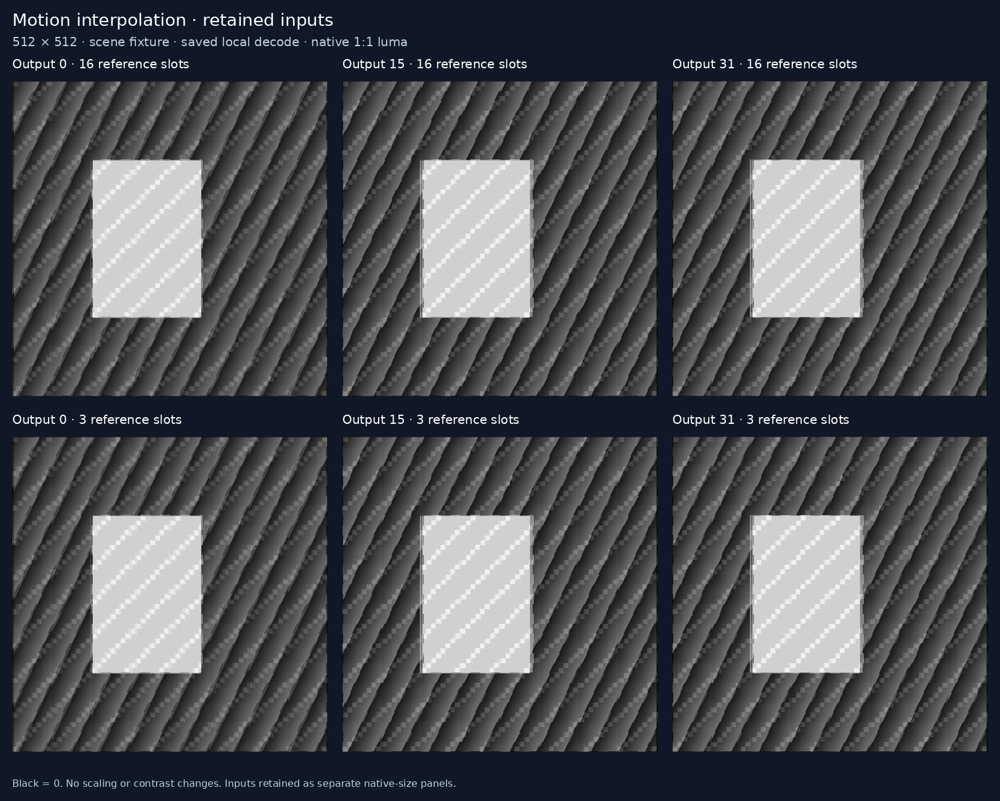

# 11 — Retained-reference streaming

This follows [experiment 10](../10-decoder-interface-limits/README.md) by loading
an input set once and computing many distinct outputs from retained decoder
references. Atlas variants and two-input supplied-motion interpolation compile
through [experiment 09's shared IR](../09-codec-compute-ir/README.md).

**Result: smaller reference declarations improve output release and batch
latency, but every host-output case still loses to native CPU on elapsed and
process CPU time.** For 32 interpolation outputs at 512×512, tighter bounds cut
NVDEC time **110.95 → 84.35 ms**; CPU takes **67.49 ms**. No submitted output
boundary completed within 50 ms in the continuous-stream probe. The
[plan](PLAN.md) distinguishes availability from complete finite-batch timing.

## Complete output-set performance

Warm median milliseconds for an entire set at 512×512, five repeats of four
changing inputs. Both NVDEC columns include native PCM preparation, one input
load per set, every requested host output, exact checks and one completion
fence. [Raw results](assets/results.json) retain all trials and lifecycle costs.

| Workload | Outputs | CPU elapsed | NVDEC, capacity 16 | NVDEC, tight capacity |
| --- | ---: | ---: | ---: | ---: |
| Patch atlas | 1 | 0.178 | 13.212 | 13.740 |
| Patch atlas | 8 | 1.933 | 45.081 | 29.782 |
| Patch atlas | 32 | 8.417 | 103.880 | 78.570 |
| Motion interpolation | 1 | 2.041 | 26.482 | 19.823 |
| Motion interpolation | 8 | 14.740 | 53.992 | 35.781 |
| Motion interpolation | 32 | 67.488 | 110.945 | 84.350 |

At 32 interpolation outputs, tight bounds reduce decoder latency **24.0%**.
Its five-trial range is **83.91–88.73 ms**, versus CPU **67.44–67.66 ms**.
Process CPU is also higher: **74.69 ms** versus **67.29 ms**, an **11.0%**
increase. Thus this finite output fan-out does not reproduce experiment 10's
CPU-resource benefit for a deep chain with only one returned result. All
host-output comparisons at both 128 and 512 lose on both metrics, with
separated trial ranges. Native-host 32-output atlas remains 9.34× slower.

Retention amortizes fixed work: tight interpolation falls from **19.82 ms per
output** for one result to **2.64 ms per output** for 32. Those are batch
throughput normalizations, not interactive completion latencies. CPU also
processes all 32 variants. Tight declarations do not help every case: the
single-output atlas median slightly regresses, with overlapping ranges.

There is one favorable **unequal-interface diagnostic**. Prepared input plus
completion-only decoding for 32 interpolation outputs takes **62.44 ms**
(56.99–63.54), versus CPU's **67.49 ms**, and uses **42.36 ms** process CPU
versus **67.29 ms**. That omits host results and exposes no consumer; prepared
input still gets decoded. Prepared-host takes **82.47 ms**, so input
serialization alone does not explain the gap. The 7.5% elapsed advantage
without results is a reason to test an actual surface consumer, not an
application speedup. The CPU baseline also does not share interpolation
planes across variants; improving it could remove that diagnostic advantage.
Do not subtract separate noisy medians to infer exact stage costs.

## Availability without resetting references

The [continuous-stream probe](assets/availability.json) checks all 96 streams
and 1,456 real pictures. At **0 of 1,312 output boundaries** did collection
return every submitted picture within 50 ms. An additional 500 ms at the end
still left pictures pending in every sequence; sole final EOS released them
all with exact pixels and counts.

Tight declarations make a large difference to how much output is held:

| 32-output sequence, both sizes and all four fixtures | Capacity 16: pending after settle | Tight capacity | Tight: pending after settle |
| --- | ---: | ---: | ---: |
| Patch atlas | 16 | 2 | 2 |
| Motion interpolation | 15 | 3 | 2 |

For those sequences the first returned sample appeared after 17–18 submitted
pictures with capacity 16, versus three for tight atlas and four for tight
interpolation. After startup the tight streams generally held one picture;
two remained at the end. This measures output availability through the
plugin, not internal hardware completion. The two paired streams perform
identical arithmetic with the same reference-slot schedule. Only reference
declarations differ. Smaller bounds help, but do not provide the missing
finish-and-resume operation.

## Compiler and runtime changes

`media.compile(..., h264_tight_dpb=True, h264_prediction_slice_rows=0)` derives
the declared reference capacity from the largest scheduled slot index plus one.
SPS reference and buffer limits, MMCO4 and writer resource validation agree.
Scheduling, original input lifetimes and pixels stay unchanged. Default
capacity remains 16 and default stream bytes are preserved.

Each graph returns 1, 8 or 32 named images. Every prediction reads the original
input(s), even more than 16 pictures later. This already worked in the shared
IR; no new pixel operation was needed. The new compiler option reduces the
declaration to the actual slot requirement. Final outputs may reuse an input
slot, so arbitrary extra appends after the planned sequence are invalid.

`NVDECStream` adds a separate bounded `append`/`collect` protocol. One initial
IDR loads the stream; subsequent non-IDR predictions preserve references.
Append success is not completion. Collection reports actual output samples,
including partial progress at a caller-selected timeout. Final close sends
one EOS and drains every pending picture. See the
[streaming contract](../decoder_core/STREAMING.md).

This tests decoded-reference retention. It does not import arbitrary CUDA
surfaces, expose a GPU consumer or estimate hardware modification cost.

## Two separate measurements

The availability probe appends one complete AU, waits up to 50 ms for output,
and checks every returned I420 byte. After the final AU it waits another
500 ms, records what remains pending, and finally drains through EOS. No extra
lookahead or IDR fence appears in these streams. Pending means not yet exposed
by the output interface; it does not establish whether the engine has already
finished decoding internally. Artificial probe waits are not throughput data.

The timing experiment uses the existing fenced runtime to compare complete
sets of 1/8/32 outputs with native CPU. One input set and one IDR completion
fence serve the entire set; no reset occurs between outputs. The native-host
mode includes native PCM serialization, input decoding, every named host
result and exact checks. CPU uses native/unrolled single-threaded `-O3`
kernels and returns every compact luma result. Individual variant contexts do
not share precomputed interpolation planes, so this is not a universally
optimal multi-output CPU implementation.

Prepared-host omits PCM generation but still decodes inputs and returns all
outputs. Prepared-complete also omits host results; it has no GPU consumer and
is an unequal-interface diagnostic. Four new full-readback requests follow
each completion-only trial outside timing. Those checks do not inspect the
earlier unread pixels.

Five rotated repeats process four changing scene/noise/zero/255 fixtures.
Reusable allocation, pipeline creation, one warmup, postflight and final fence
drain are excluded; their lifecycle times are recorded. Process CPU includes
parent and live helper threads, excluding other processes, IRQs and kernel
workqueues. No energy is measured. Timings are reported for the full output
set and explicitly normalized per output; batch throughput does not establish
interactive latency.

## Next interface to test

The useful contract is **finish this submitted prefix, release its outputs,
then resume using the same reference pictures**. Current `collect` only waits
for samples, and current `close` ends the pipeline. Neither exercises an
explicit state-preserving decoder drain.

Linux already specifies a candidate: `V4L2_DEC_CMD_STOP`, dequeue all submitted
input buffers and capture buffers through `LAST`, then `V4L2_DEC_CMD_START`
resumes with the previous state.
The standard also describes an optional `VIDIOC_TRY_DECODER_CMD` capability
query. This is a documented interface contract, not evidence that the tested
NVDEC driver/plugin implements it. See the
[stateful decoder drain specification](https://docs.kernel.org/userspace-api/media/v4l/dev-decoder.html#drain).

Use a separate harness that owns the queues, or deliberately integrate with
the plugin; do not inject commands behind GStreamer's buffer ownership.
The next bounded test should run that sequence at an intermediate output,
resume with a non-IDR prediction that reads an old retained input, and check
every pixel, timestamp and buffer count. It must include weighted B pictures,
a later dependency on a previous output and repeated drains, with neither new
input pictures nor an IDR reset. Compare
its measured boundary latency against the current fence path. If supported,
this could be a runtime integration change; it would not require inventing a
new silicon primitive.

If that fails, the narrow request to a decoder implementer is explicit
completion plus output-buffer access while preserving reference ownership.
Only after tracing the unsupported layer should this become a firmware or
hardware proposal. Surface import and a real downstream GPU consumer remain
separate experiments. Their implementation cost, energy and performance are
unknown here.

Low-latency switches are not an equivalent general solution: the
[documented plugin low-latency mode](https://docs.nvidia.com/metropolis/deepstream/9.1/text/DS_plugin_gst-nvvideo4linux2.html#gst-properties)
targets streams without B pictures, while the interpolation program emits
weighted B predictions. No such switch or DPB-disable control was enabled.

## Capture and provenance



The capture shows outputs 0, 15 and 31 at native 1:1 scale, with default and
tight declarations on separate rows. It displays saved local decoder results;
NVDEC exactness is checked independently in the hardware reports. The
[atlas capture](assets/patch-atlas-outputs-512.png) uses the same layout. Black
samples remain zero, and separate native-size input panels are retained.

The frozen export contains **96 streams / 1,456 pictures / 1,312 named
outputs**. All **288 FFmpeg/OpenH264/VA-API stream checks** pass, and all 656
paired named outputs match between declarations. Independent native CPU
results, zero guards and neutral chroma construct each complete I420 reference;
no computed result is encoded into a prediction picture. Four fixtures include
changing scene/noise inputs and both byte extrema. Every noise output within
a multi-output sequence is distinct.

The NVDEC availability probe and fenced benchmark preflight each check all
**1,456 real I420 pictures**; preflight additionally accounts for 96 IDR
fences. All **420 timing trials** pass. Completion-only trials copy zero timed
pictures, followed by **480 new postflight requests / 7,280 real pictures**
outside timing. Every final drain accounts for pending pictures and fences.
Postflight validates the live path and frozen inputs, not earlier unread
results. Report identities match the export and worker build record.

[full-bundle.json](assets/full-bundle.json) preserves the exact export index
and 127 source hashes at commit `9e18edf`.
[curation.json](assets/curation.json) inventories the retained subset and
omissions; [capture.json](assets/capture.json) binds panels to saved pixels.
The curator rechecks 286 source artifacts, 134 complete I420 pictures, 128
named crops and two complete-sequence declaration pairs. The
[helper build record](assets/helper-build.json) binds the NVDEC executable to
its source. Native CPU/PCM build flags and binary hashes accompany timings.

Validation passes **193 shared compiler tests**, **127 decoder-core tests**,
**12 runtime/tooling tests** and **three exporter tests**. Separate 31-test
stream/session coverage overlaps the decoder-core suite; these are not additive
counts. Tight-capacity tests also cover single-slot recurrences, two-slot
long-lived inputs, default byte compatibility and native PCM output.

## Reproduce

Run from the repository root on a compiler host:

Commit `9e18edf` identifies the measured source snapshot. Regeneration from
later compiler code creates a new export and requires new source-bound results.

```sh
python3 codec_compute/workloads/interface_limits/build.py codec_compute/artifacts/retained-build
python3 -m codec_compute.workloads.retained_inputs.prepare \
  --output codec_compute/artifacts/retained-inputs-full \
  --cpu-helper codec_compute/artifacts/retained-build/libcpu.so
```

Defaults export both sizes 128/512, both workloads, 1/8/32 outputs, four
fixtures and both DPB policies. All FFmpeg/OpenH264/VA-API paths are required.
Copy the complete export plus pinned source tree to an NVDEC host. Build the
current helper using [existing build instructions](../05-h264-compiler/native_ops/nvdec/README.md)
and compile native CPU/PCM helpers there:

```sh
python3 codec_compute/workloads/interface_limits/build.py native
python3 codec_compute/workloads/retained_inputs/probe.py bundle \
  --nvdec-helper /path/to/nvdec_decode --wait-ms 50 --output availability.json
python3 codec_compute/workloads/retained_inputs/benchmark.py bundle \
  --cpu-helper native/libcpu.so --pcm-helper native/libpcm.so \
  --nvdec-helper /path/to/nvdec_decode --build-info native/build.json \
  --repeats 5 --output results.json
```

No installation, clock/power/priority changes or decoder-management overrides
are part of these runs. The build and source hashes bind the chosen helper.
To regenerate the saved-pixel capture and representative evidence:

```sh
python3 11-retained-reference-streaming/curate.py \
  --bundle codec_compute/artifacts/retained-inputs-full/bundle.json \
  --output /path/to/evidence
python3 11-retained-reference-streaming/curate.py --audit /path/to/evidence
```

The curated evidence contains only four 512×512, 32-output scene sequences:
both workloads and both declarations. Its full index preserves metadata for
all 96 streams, with omissions explicit. It is not a runnable benchmark bundle.
