# Media experiments

What if hardware decoders were just another general purpose accelerator?

## Decoder output gallery

Actual decoder captures from the experiments. Select a preview to open its project.

<table>
  <tr>
    <td width="50%" valign="top">
      <a href="01-conways-decoder-of-life/README.md"><strong>01 — Conway's decoder of Life</strong> 
      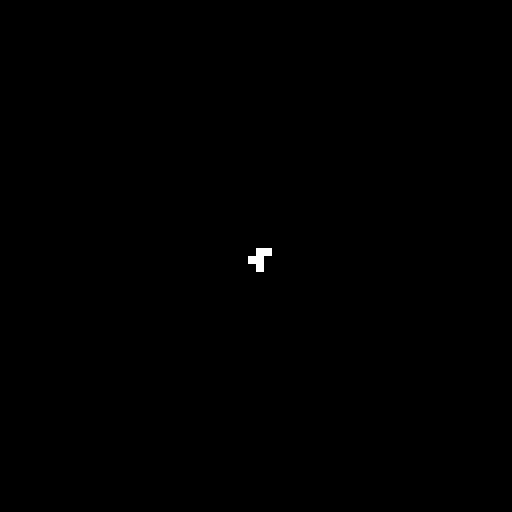</a>
      
Motion compensation, weighted prediction, and clipping compute each generation.

    </td>
    <td width="50%" valign="top">
      <a href="02-maze-flood-fill-decoder-solver/README.md"><strong>02 — Maze flood-fill solver</strong> 
      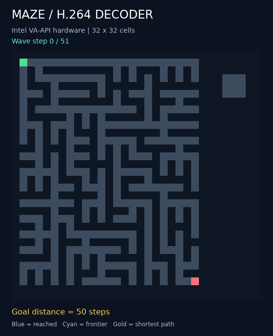</a>
      
Decoded reachability expands through the maze; arrival times reveal a shortest path.

    </td>
  </tr>
  <tr>
    <td width="50%" valign="top">
      <a href="03-denoising-decoder/README.md"><strong>03 — Denoising decoder</strong> 
      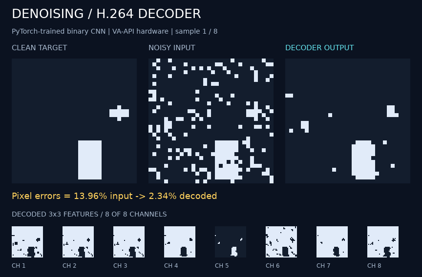</a>
      
A trained binary CNN runs as H.264 prediction operations.

    </td>
    <td width="50%" valign="top">
      <a href="04-binary-mnist-classification-decoder/README.md"><strong>04 — MNIST classification</strong> 
      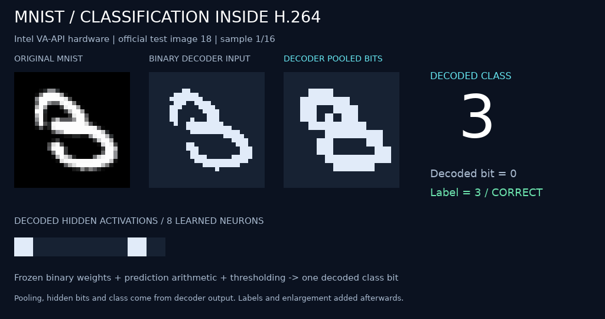</a>
      
Decoder pooling, signed arithmetic, and thresholds distinguish handwritten 3s and 8s.

    </td>
  </tr>
  <tr>
    <td width="50%" valign="top">
      <a href="06-motion-mask-decoder/README.md"><strong>06 — Motion-mask decoder</strong> 
      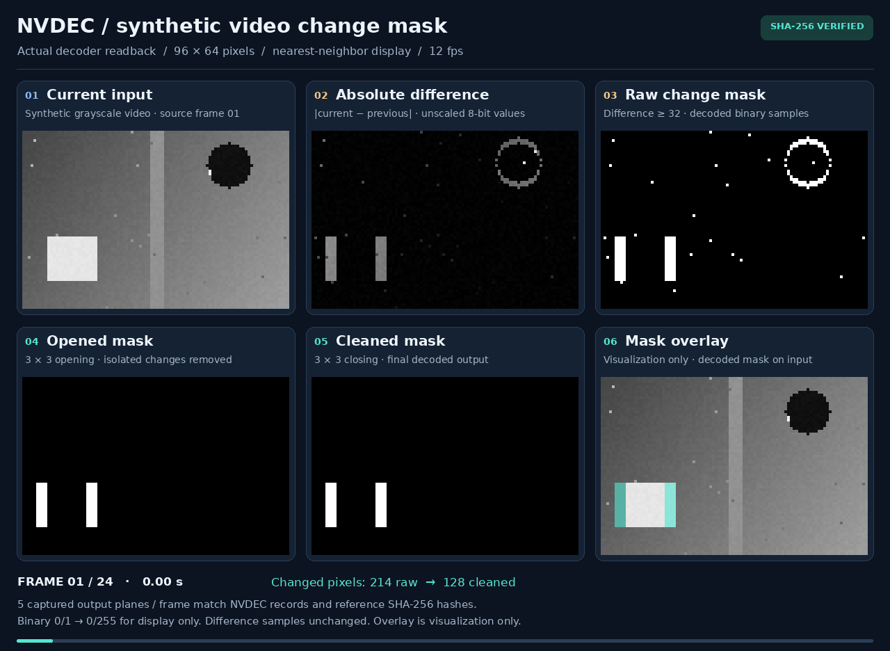</a>
      
Frame differences, thresholding, and binary cleanup produce motion masks.

    </td>
    <td width="50%" valign="top">
      <a href="07-packed-denoising-decoder/README.md"><strong>07 — Packed denoising</strong> 
      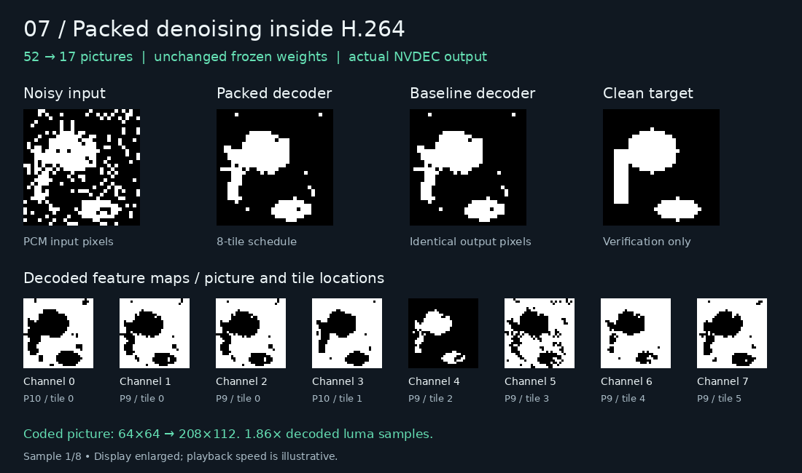</a>
      
Packing independent features into picture tiles reduces 52 pictures to 17.

    </td>
  </tr>
</table>

Compiler, shared IR, and streaming screenshots

<table>
  <tr>
    <td width="50%" valign="top">
      <a href="05-h264-compiler/native_ops/README.md"><strong>05 — Native decoder operations</strong> 
      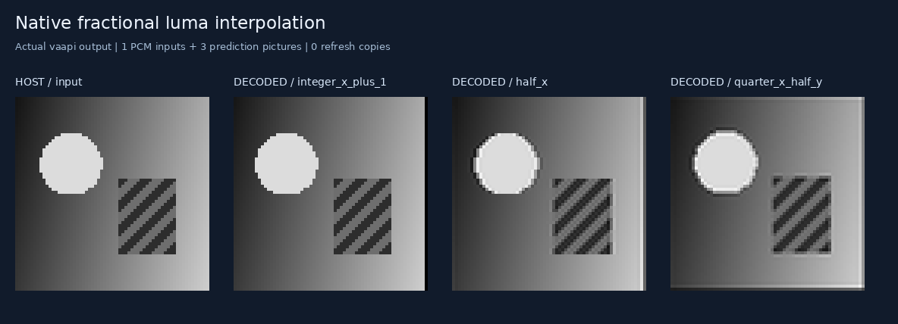</a>
      
Fractional motion compensation supplies native interpolation.

    </td>
    <td width="50%" valign="top">
      <a href="08-decoder-compute-limits/README.md"><strong>08 — Boolean computation</strong> 
      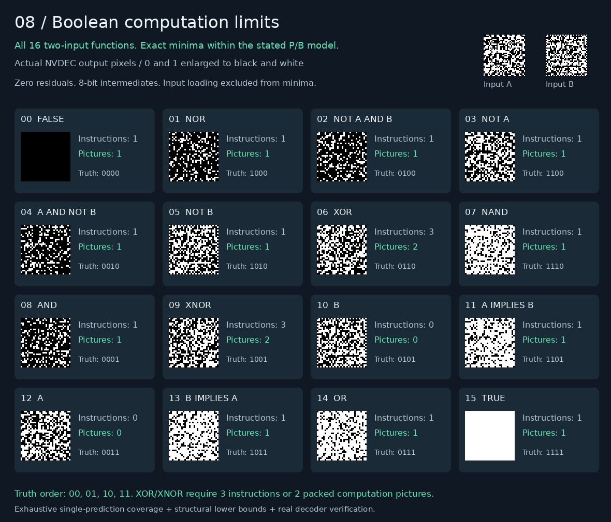</a>
      
All sixteen two-input Boolean functions, captured from NVDEC.

    </td>
  </tr>
  <tr>
    <td width="50%" valign="top">
      <a href="codec_compute/workloads/README.md"><strong>09 — Shared image-compute IR</strong> 
      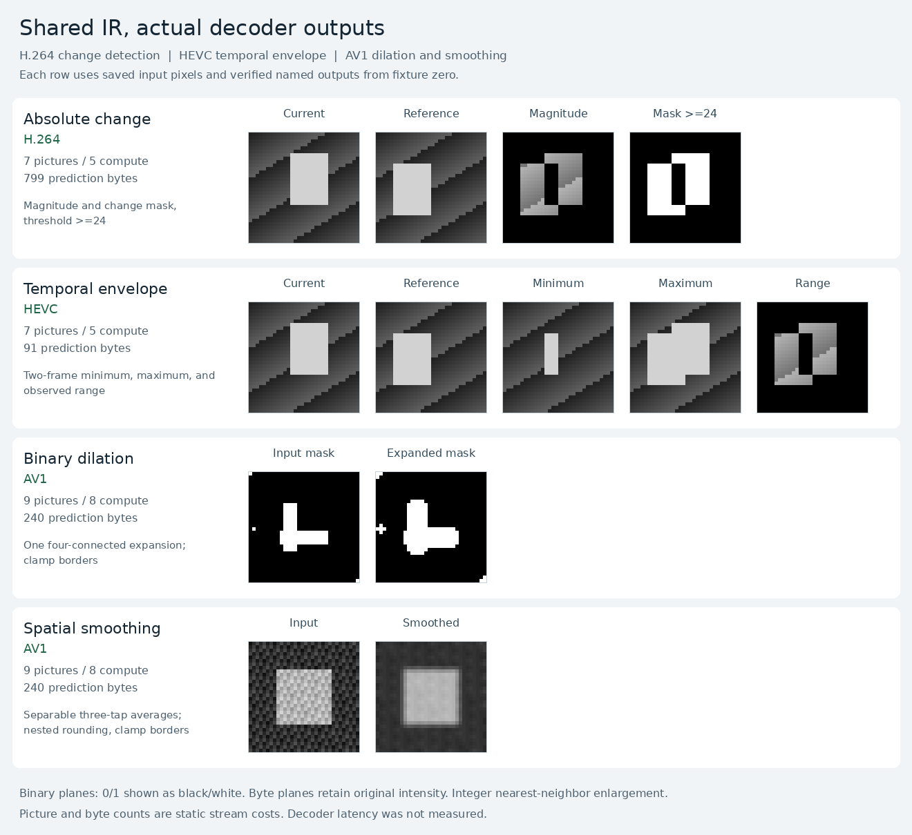</a>
      
Change detection, blending, mask expansion, and smoothing share an exact image IR.

    </td>
    <td width="50%" valign="top">
      <a href="codec_compute/workloads/resampling/README.md"><strong>09 — Resampling and routing</strong> 
      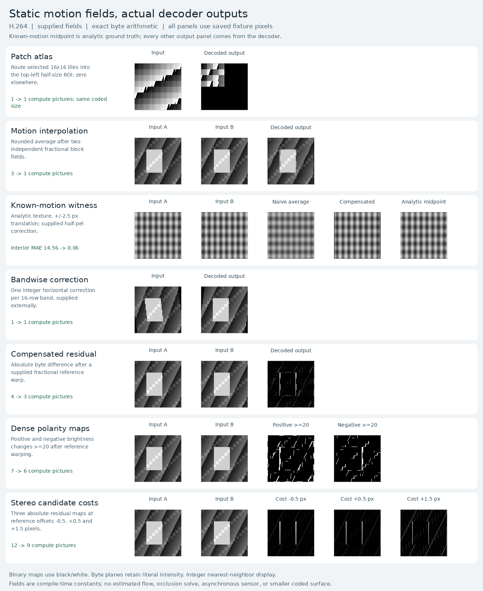</a>
      
Block routing and fractional sampling build atlases and motion-compensated outputs.

    </td>
  </tr>
  <tr>
    <td width="50%" valign="top">
      <a href="10-decoder-interface-limits/README.md"><strong>10 — Decoder interface limits</strong> 
      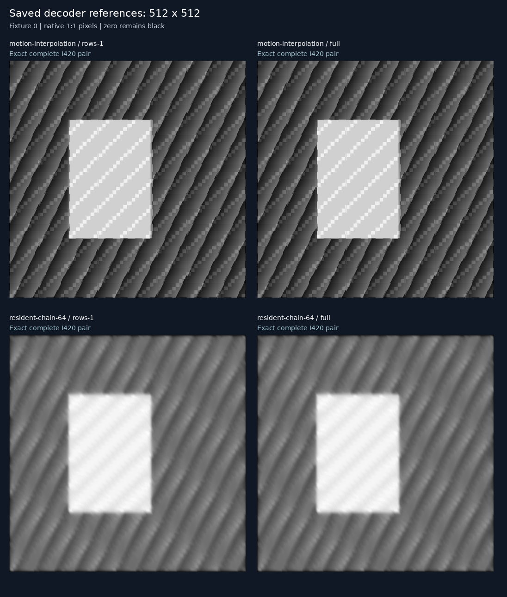</a>
      
Different slice layouts preserve the same decoded results.

    </td>
    <td width="50%" valign="top">
      <a href="11-retained-reference-streaming/README.md"><strong>11 — Retained-reference streaming</strong> 
      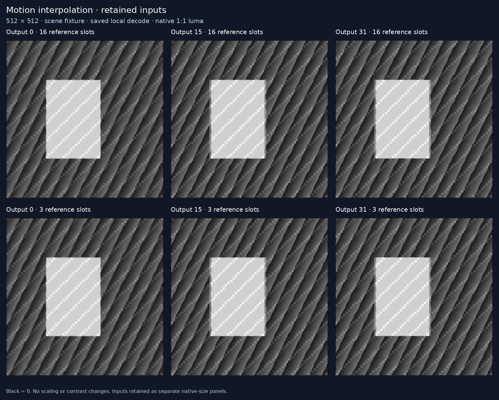</a>
      
Retained input pictures feed multiple interpolation outputs.

    </td>
  </tr>
</table>

## Experiments

- [01 — Conway's decoder of Life](01-conways-decoder-of-life/README.md): a generated
  H.264 bitstream makes software and hardware video decoders compute Conway's
  Game of Life using motion compensation, weighted prediction, and clipping.
- [02 — Maze flood-fill decoder solver](02-maze-flood-fill-decoder-solver/README.md):
  the decoder expands reachability through a maze; decoded arrival times provide
  shortest distances and paths while walls block propagation.
- [03 — Denoising decoder](03-denoising-decoder/README.md): a PyTorch-trained binary
  CNN compiles into H.264 prediction operations, including signed 3×3 filters,
  binary feature maps, and a streaming 1×1 output layer.
- [04 — Binary MNIST classification decoder](04-binary-mnist-classification-decoder/README.md):
  a trained binary network classifies handwritten 3s versus 8s using decoder
  pooling, signed arithmetic, and thresholds; 94.96% accuracy on the official
  two-class test subset.
- [05 — Python H.264 compiler](05-h264-compiler/README.md): the legacy frontend,
  deprecated for new work in favor of experiment 09. Its backend and packing
  remain in use, with exact arithmetic, shift fusion, common-expression elimination,
  reference scheduling, and inspectable instruction manifests. Its
  [native-operation demos](05-h264-compiler/native_ops/README.md) add multiple
  input images, saturating arithmetic, block gathers, and quarter-pixel interpolation,
  with measured input-loading and decoder costs.
- [06 — Motion-mask decoder](06-motion-mask-decoder/README.md): frame differences,
  thresholding, and binary mask cleanup; persistent NVDEC batches and selective
  output readback, with exact captures and measured costs.
- [07 — Packed denoising decoder](07-packed-denoising-decoder/README.md): independent
  neural feature calculations share picture tiles, reducing 52 pictures to 17;
  unchanged weights, exact outputs, and paired NVDEC measurements.
- [08 — Decoder computation limits](08-decoder-compute-limits/README.md): proved
  minima for all 16 two-input Boolean functions, synthesis/scheduling tradeoffs,
  measured decoder costs, and exact denoising alongside CUDA workloads.
- [09 — Exact image compute IR](09-codec-compute-ir/README.md): the current
  frontend for new work, with exact image semantics, bounded synthesis, H.264/
  HEVC/AV1 targets, resident execution and measured CPU comparisons. Includes
  migration guidance; the `codec_compute` package keeps its existing path.
- [10 — Decoder interface limits](10-decoder-interface-limits/README.md): opt-in
  prediction slice bands and explicit completion-only diagnostics distinguish
  instruction layout from input, output and consumer-interface costs.
- [11 — Retained-reference streaming](11-retained-reference-streaming/README.md):
  shared inputs feed many named outputs; bounded streaming and schedule-derived
  reference declarations test completion behavior without resetting each output.

Compiler variants: [Life](01-conways-decoder-of-life/compiled/README.md) ·
[Maze](02-maze-flood-fill-decoder-solver/compiled/README.md) ·
[Denoising](03-denoising-decoder/compiled/README.md) ·
[MNIST](04-binary-mnist-classification-decoder/compiled/README.md).

The experiments use the shared [H.264 writer and decoder tools](decoder_core).

[Experiment 09](09-codec-compute-ir/README.md) is the canonical starting point
for the multi-codec compute IR. Its [implementation and API reference](codec_compute/README.md)
remain under `codec_compute`. H.264 backend reuse, independently implemented
HEVC/AV1 targets, explicit unsupported operations and reusable computation tails
are documented alongside exact-decoder evidence.

[Automatic computation synthesis](codec_compute/synthesis/README.md): generic
bounded search discovers min/max and Boolean AND/OR/XOR implementations from
exact codec primitive descriptions, retains exhaustive scalar verification
records, and emits real H.264/HEVC/AV1 programs for successful searches.

[Shared IR workload survey](codec_compute/workloads/README.md): exact change
detection, temporal extrema, blending, binary mask expansion, and rounded
smoothing across decoder targets. Includes an `absdiff` operation, actual
captures, target limits, and measured picture/input/byte costs.

[IR resampling experiments](codec_compute/workloads/resampling/README.md): patch
atlases, motion-compensated interpolation, bandwise correction, compensated
residuals, dense polarity maps, and stereo cost candidates. Adds explicit
H.264 fractional sampling and per-block routing to the shared IR, including
two independently warped references blended in one prediction picture.

[Resident IR runtime](codec_compute/workloads/resident/README.md): explicit
level-4.1 support for 256×256 inputs and sequential NVDEC requests through one
live decoder pipeline. Includes counted IDR completion fences, exact output
checks, and fresh-session versus warmed-session measurements.

[CPU versus decoder](codec_compute/workloads/cpu_comparison/README.md):
matched native CPU kernels, accelerated input serialization, resident chains
and finite batches. CPU wins every elapsed-time comparison. In this original
comparison, one synthetic 64-stage chain saves 14.2% host process CPU on NVDEC
but finishes 6.22× slower.

[Zero-guard merging and CPU offload](codec_compute/workloads/guard_fusion/README.md):
shared compiler row slices fall from 98 to 34 at 512×512, with identical pixels.
For 64 stages, NVDEC elapsed time falls 60.3%; it uses 39.1% less process CPU
than native CPU but remains 2.49× slower. Controlled contention shows a small
1.85% median background-work gain, with all 60 merged requests within deadline;
trial ranges overlap, so application benefit needs further validation.

[NVDEC validation](05-h264-compiler/native_ops/nvdec/README.md):
34 cases and 6,116 decoded pictures matched exactly on NVDEC, including all
four compiled experiments. Captures, timings, and reproduction commands included.

[Compiler optimization results](05-h264-compiler/optimizations/README.md):
Boolean and threshold lowering, grouped prediction slices, retained reference
slots, and exact comparisons across all six experiments.

[Exact instruction search](05-h264-compiler/optimizations/exact-search/README.md):
proved small-domain replacements reduce Life from 682 to 402 pictures and
denoising from 58 to 52, with decoder captures and paired NVDEC measurements.

[Semantic IR improvements](05-h264-compiler/optimizations/ir/README.md):
Boolean value propagation removes redundant computation, equivalent outputs
share results, and mixed P/B packing reduces four-tile denoising from 20 pictures
to 19 while preserving every named output.

[Packed schedule selection](05-h264-compiler/optimizations/packing/README.md):
critical-path scheduling reduces four-tile denoising further, from 19 pictures
to 17, while guarding prediction slices, bytes, and named-output readback costs.

[Maze kernel and readback improvements](02-maze-flood-fill-decoder-solver/compiled/optimizations/README.md):
265 → 214 decoded pictures, 265 → 54 NVDEC copies, and a measured 1.12× speedup
while preserving every flood state and shortest distance.
