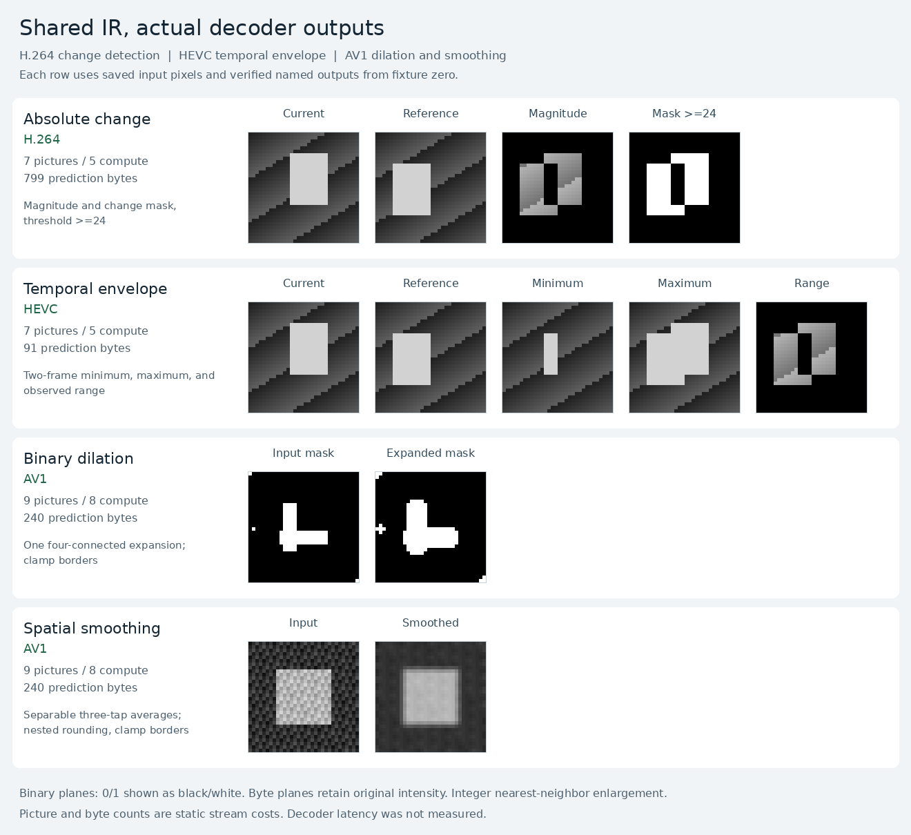

# Tasks that fit the shared decoder IR

The strongest small candidates are **temporal averaging, directional change,
and absolute change**. They use one to three arithmetic pictures before any
optional mask. Binary dilation and explicitly rounded smoothing also work.
Grayscale morphology is expressible, but costs substantially more pictures.

This survey compiles the same nine task graphs for H.264, HEVC, and AV1.
**14 of 27 task/target combinations execute exactly.** The other combinations
record unsupported backend operations or bounded synthesis misses. The compiler
does not change arithmetic, borders, or input data to accommodate a target.



The capture shows actual decoded results: H.264 change detection, HEVC temporal
extrema, and AV1 mask expansion and smoothing. Binary values are displayed as
black/white; byte images retain their intensities.

## Measured operation counts

These are **computation pictures**, excluding the input pictures in column two.
All examples have 32×32 logical pixels. A dash means this implementation did
not produce a program; it is not a codec impossibility result.

| Task | Inputs | H.264 | HEVC | AV1 |
| --- | ---: | ---: | ---: | ---: |
| Positive change, `max(current-reference,0)` | 2 | **1** | **1** | — |
| Absolute change plus cutoff-24 mask | 2 | **5** | **6** | — |
| Two-frame minimum, maximum, and range | 2 | **5** | **5** | — |
| Rounded temporal average | 2 | **1** | **1** | **1** |
| Cross-shaped binary dilation, zero border | 1 | **8** | — | — |
| Cross-shaped binary dilation, clamp border | 1 | — | — | **8** |
| Nested rounded smoothing, zero border | 1 | **8** | — | — |
| Nested rounded smoothing, clamp border | 1 | — | — | **8** |
| Cross-shaped grayscale min/max/range, zero border | 1 | **21** | — | — |

Absolute difference alone uses **three** compute pictures on H.264 and HEVC.
It is now a first-class semantic operation:

```python
import codec_compute as media

def changes(a, b):
    magnitude = media.absdiff(a, b)
    return {"magnitude": magnitude, "mask": media.threshold(magnitude, 24)}

program = media.compile(changes, target="hevc", width=32, height=32,
                        input_ranges={"a": (0, 255), "b": (0, 255)})
program.save("changes.hevc", {"a": current, "b": reference})
```

The generic scalar synthesizer discovers its implementation from the existing
primitive catalog and verifies all 65,536 byte pairs. No function-specific
instruction recipe was added. Its conservative range is checked before search,
and the original semantic graph remains the independent interpreter's input.
The current AV1 average-only catalog finds no full-byte absolute-difference
plan within the default three-application bound.

## What to pursue

1. **Temporal blend and change preprocessing.** These have the shortest
   resident arithmetic chains. Directional change is sufficient when only
   brightening matters; absolute difference covers both directions. The mask
   remains decoder-computed. This is the best next family to benchmark.
2. **Background or exposure envelopes.** The two-frame extrema task exposes
   both bounds and their span within HEVC's three-reference limit. If only the
   span matters, use the cheaper three-picture absolute difference. These are
   finite two-input jobs; an ongoing video pipeline still needs integration.
3. **Binary mask growth and rounded image smoothing.** AV1 runs these with
   clamp borders, while this H.264 backend runs zero-border variants. Four
   translation pictures are currently materialized separately. Folding those
   reads into prediction consumers is a promising compiler follow-up.
4. **Grayscale local contrast.** The five-point min/max construction works on
   H.264 but requires 21 computation pictures. Keep it as an exploratory
   workload until a shorter implementation or measured benefit justifies it.

These results establish exact execution. Decoder latency and concurrent GPU
workloads were **not measured** here. Every standalone program uploads its inputs.
For these fixtures, H.264's two-input prefix is **15,483 bytes**, versus **171
prediction bytes** for a one-picture blend or positive-change operation.
Input loading can dominate such a small computation. A future pipeline that
reuses decoder-resident data is therefore more interesting than repeated
standalone uploads; this demo does not implement that integration.

The report records input-prefix bytes separately from prediction bytes.
HEVC/AV1 lossless inputs depend on image content. Codec framing, coded geometry,
and chroma differ, so byte sizes alone do not establish a faster target.

## Exact semantics and boundaries

- Boolean dilation accepts literal **0/1**, not 0/255. Its neighborhood contains
  the center and four axial neighbors. Rounded average is exact OR on that
  domain. Including the center means zero and clamp borders give the same
  dilation result here, although their graph contracts remain distinct.
- Smoothing computes `avg(avg(left,right),center)`, then the analogous vertical
  stage. Each `avg(a,b)` is `(a+b+1)//2`. This is not a single rounding of a
  convolution: a center pixel of one surrounded by zeros remains one under
  the nested rule, whereas the corresponding single-rounded weighted sum is
  zero. Zero borders also darken constant images at the edge; clamp borders
  preserve them.
- Grayscale local range includes zero padding. Edge contrast caused by that
  padding is intentional and is checked by the reference formula.
- HEVC spatial shifts are unimplemented in this backend. H.264 clamp borders
  and AV1 nonzero shifts with zero borders are also unimplemented. AV1's
  min/max/absolute-difference search misses concern the current finite grammar.

## Evidence and reproduction

[validation.json](assets/validation.json) records **28 saved streams, 62 local
decoder runs, and 45,056 named output pixels**. Every accepted graph runs with
two distinct input fixtures and an identical computation tail. The runner
decodes the exact saved files and compares their named outputs with both the
semantic IR and independent task formulas. H.264 uses FFmpeg, OpenH264, and
VA-API; HEVC uses FFmpeg; AV1 uses libdav1d and libaom-av1. Full decoded planes
also agree across available decoders for each stream. HEVC's recorded full
comparison covers luma; H.264 includes guarded I420; AV1 is monochrome.

[NVDEC validation](assets/nvdec-validation.json) passes all **14 H.264 streams**,
covering **120 pictures and 737,280 I420 bytes** across both input fixtures for
every supported H.264 workload. The
[suite index](assets/nvdec-suite.json) identifies exact stream and output hashes.
HEVC and AV1 hardware execution was not tested.

The complete shared-IR suite passes **113 tests, with no skips**. New tests
decode all 65,536 byte pairs for absolute difference on both H.264 and HEVC,
check forged range rejection, preserve aliases and composed thresholds, and
forbid runtime synthesis or interpreter calls during encoding/decoding. Task
tests additionally cover every binary cross neighborhood, signed direction,
extrema, explicit borders, and the nested-rounding counterexample.

Source hashes include the shared compiler, H.264 backend, AV1 bridge C source,
serializer patch, and actual serializer executable. The report also records
the pinned libaom revision. Captures have their own plane and stream hashes.
The full bundle is reproducible under ignored `codec_compute/artifacts/workloads`;
[first-fixture streams](assets/streams) for all 14 supported combinations and
the capture inputs/outputs are included under `assets`. The full report indexes
both fixtures; regenerate the bundle to reproduce every indexed artifact.

From the repository root, using the existing [codec dependencies](../README.md):

```sh
python3 -m unittest discover -s codec_compute/tests -v
python3 -m codec_compute.workloads.demo
python3 -m codec_compute.workloads.capture codec_compute/artifacts/workloads \
  --output codec_compute/workloads/assets/capture.png
```

Use `--target h264` or `--target hevc` without the AV1 serializer. `--tasks`
selects specific workloads. No model training, dataset downloads, or automatic
dependency installation occur.

The saved H.264 cases can be checked with the existing portable NVDEC runner:

```sh
python3 -m codec_compute.workloads.export_h264 codec_compute/artifacts/workloads
python3 05-h264-compiler/optimizations/ir/validate.py \
  codec_compute/artifacts/workloads --backend nvdec \
  --helper decoder_core/.build/nvdec_decode \
  --output codec_compute/artifacts/workloads/nvdec-validation.json
```

Copy the prepared bundle, validator, and `decoder_core/decode.py` to the decoder
environment first. The validation runner needs neither the compiler nor the
HEVC/AV1 serializers.
