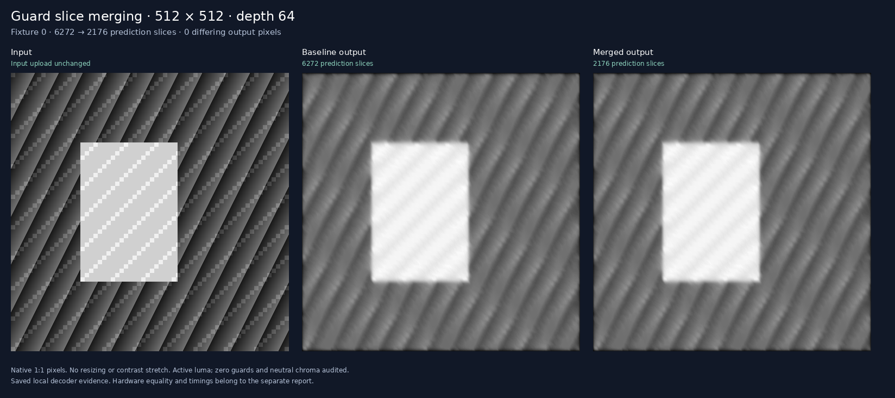

# Guard merging, crossover and controlled CPU contention

This experiment changes prediction headers while preserving every decoded
picture. It compares the old row layout and shared compiler's new zero-guard
merging against the same tuned native CPU recurrence. A separate experiment
asks whether offloading foreground work improves background CPU progress at
an identical request rate and deadline.

## Measured crossover

For the 64-stage chain, guard merging lowers median NVDEC elapsed time from
**518.23 to 205.67 ms** (60.3%) and process CPU from **71.13 to 49.85 ms** (29.9%).
The tuned CPU still finishes in **82.45 ms**. Merged NVDEC therefore takes
**2.49× longer**, while using **39.1% less measured process CPU** than the CPU's
81.81 ms. This establishes a narrower CPU-resource benefit, not a latency win.

All values below are milliseconds per request: median of five eight-request
trials. Old/new refer to the paired baseline/merged prediction layouts.

| Stages | CPU elapsed | NVDEC old elapsed | NVDEC new elapsed | CPU process time | NVDEC old process time | NVDEC new process time |
| --- | ---: | ---: | ---: | ---: | ---: | ---: |
| 1 | 1.47 | 23.61 | 18.98 | 1.47 | 10.43 | 10.76 |
| 4 | 5.54 | 46.05 | 28.65 | 5.31 | 13.52 | 12.26 |
| 8 | 10.42 | 75.18 | 38.33 | 10.38 | 14.97 | 14.56 |
| 16 | 20.61 | 140.84 | 63.73 | 20.57 | 21.75 | 21.21 |
| 32 | 41.34 | 265.61 | 107.83 | 41.00 | 37.06 | 29.19 |
| 64 | 82.45 | 518.23 | 205.67 | 81.81 | 71.13 | 49.85 |

At 32 stages, merged NVDEC uses **28.8% less process CPU**: 29.19 versus
41.00 ms. Its five-trial range (28.45–30.74 ms) stays below the CPU range
(40.93–41.11 ms). At 64 stages the corresponding ranges are 47.87–67.10 and
81.72–82.13 ms. **32 stages is the earliest tested depth with separated CPU-time
ranges.** At 16 stages, merged NVDEC's 17.52–25.73 ms overlaps the CPU's
20.56–20.70 ms; the exact crossover between tested depths is not established.
Every tested depth still loses to CPU elapsed time.

The [raw crossover report](assets/crossover.json) preserves all 90 trials,
including variation, setup phases, live process clocks and final decoder
counters. Smaller layouts reduce prediction bytes too: for 64 stages,
229,376 → 151,616 bytes (33.9%), with unchanged input bytes and picture count.

## Measured background progress

At the same one-request/second rate and 750 ms deadline, merged NVDEC leaves
**1.85% more background throughput by median** than CPU: 920.50 versus 903.75
checked PBKDF2 chunks/second. Both complete all **60/60 foreground requests
within deadline**. The old decoder layout misses **4/60** deadlines, so its
background result does not qualify for this service target.

Each background sample is one fixed 12-second window; the response median pools
the 60 foreground jobs. There are five windows per mode, twenty trials total.

| Foreground mode | Median background chunks/s | Five-window range | Median response ms | Deadline misses/jobs |
| --- | ---: | ---: | ---: | ---: |
| Background only | 986.83 | 964.92–997.67 | — | — |
| CPU | 903.75 | 897.83–918.92 | 158.64 | 0/60 |
| NVDEC old | 910.42 | 907.58–931.83 | 644.17 | 4/60 |
| NVDEC merged | 920.50 | 917.75–927.67 | 287.18 | 0/60 |

The merged-minus-CPU background difference is positive in every repeat:
**+0.28%, +0.57%, +1.85%, +2.00% and +3.32%** when sorted. However, absolute
trial ranges overlap and the no-foreground control varies from 964.92 to
997.67 chunks/s. This is a small observed benefit for this synthetic workload,
not evidence of a general application-throughput improvement. Longer runs and
an actual CPU-constrained application are needed before treating it as one.

Foreground process CPU over each twelve-request trial falls from a median
996.09 ms on CPU to 621.90 ms on merged NVDEC (37.6%). These are separately
measured contention totals, not an extrapolation from isolated timings. Response
time remains worse: 287.18 ms median on merged NVDEC versus 158.64 ms on CPU;
the largest observed merged response is 463.18 ms. No request was dropped or
completed beyond its observation window. All outputs match exactly.

The [raw contention report](assets/concurrency.json) includes every release,
response, background completion count, boundary overrun, thread affinity,
scheduling policy, process clock and final decoder count. Protocol success and
deadline qualification are separate fields. This measured CPU-resource benefit
does not establish lower energy use, latency superiority or production value.

## What changed

At 512×512 active pixels, the old layout emits 98 slices per prediction:
three runs across each of 32 active rows, plus the top and bottom guards.
Compatible zero-offset operations can instead keep their normal prediction
headers on guard blocks, setting guard motion to zero. Referenced guards are
already zero, so every predicted guard sample stays zero. That produces
34 row slices. Rows remain separate; motion-vector prediction is unchanged.

Opt in on the direct Writer with `merge_zero_guards=True`; its default `False`
preserves previous stream bytes. Shared `compile` and `compile_graph` enable
`h264_merge_zero_guards=True` by default. Disabling it produces the paired
baseline. Nonzero offsets, mixed block headers and macroblock mode retain the
old policy. See [exact guard semantics](../../../decoder_core/GUARDS.md).

Both layouts use one PCM input, the same computation pictures, retained
references and one final output. Each stage averages two codec-defined
fractional reads with quarter-pixel displacements `(1, 2)` and `(-1, -2)`.
Every rounding and clipping step is retained. Depths are 1, 4, 8, 16, 32 and 64;
each has eight changing scene/noise/zero/255 fixtures. Baseline and merged
inputs, input access units, and complete decoded I420 must be identical.

The CPU uses the previously validated shared-filter C++ recurrence, compiled
with `-O3`, native code generation and loop unrolling. It reuses separable
half-sample calculations and scratch, performs all stages, and returns only
the final image. The measurement binary is byte-identical to the prior
native/unrolled tuning winner. The runtime rejects generic or untuned CPU build records.
It performs no host graph evaluation or instruction generation during timing.

## Isolated crossover measurement

All real decoded pictures are checked through a live NVDEC session before
timing. Local export also checks FFmpeg, OpenH264 and VA-API. Timings use five
rotated/reversed repeats of CPU, baseline NVDEC and merged NVDEC at each depth,
with eight requests per trial. Every request validates exact output.

NVDEC starts from compact host bytes, uses the exact native PCM serializer,
decodes the input and computation, adds one counted completion fence, and reads
back the selected full I420 output. CPU calls return compact bytes. Both include
output allocation and comparison. Context creation, one warmup and final close
are excluded from warm timings; decoder lifecycle phases are recorded.

CPU time sums parent and live decoder process clocks. It includes their threads
but excludes other processes, interrupts and kernel workqueues. These are
implementation comparisons, not isolated hardware throughput or energy.

## Controlled background work

The contention experiment shares one logical CPU among runner, helper threads
and a background worker. Affinity and scheduling settings are audited; original
runner affinity is restored. No clocks, global power settings or priorities are
changed. Driver/kernel work can still execute outside this process affinity
budget, so this is not a whole-system resource or energy measurement.

Modes are background-only, tuned CPU, baseline NVDEC and merged NVDEC. Five
rotated repeats use fixed twelve-second windows. Foreground modes execute the
64-stage program at absolute one-second releases, with 750 ms deadlines measured
from release through exact output verification. Overdue jobs remain queued;
none are silently dropped. Late dispatch, response/service time, deadline misses
and completions after the observation window remain explicit.

Background work repeatedly computes and checks a fixed public
PBKDF2-HMAC-SHA256 result. Chunk size is calibrated once, then held constant
across modes. Workers are ready and armed before the shared timestamp barrier.
Only chunks completed inside the fixed window count toward throughput, even
if foreground work runs late. Boundary work and CPU-accounting offsets are
reported separately. Process CPU totals extending through backlog/boundary
completion must not be read as exact fixed-window CPU usage.

A protocol pass establishes exact outputs and consistent accounting. It does
not imply deadline qualification or a performance win. Background throughput
must be interpreted alongside foreground deadlines and raw repeat variation.
This synthetic mixed workload is not a production application benchmark.

## What this suggests next

Keep the guard optimization: it preserves exact output and substantially
reduces decoder cost on the longer tested chains. Small tasks still lose both
CPU time and latency, so this does not justify moving ordinary image filters
off CPU by itself.

The next useful test is a real pipeline with an already-required video decode,
reused decoder-resident inputs, and a CPU-bound consumer. Measure complete
request deadlines and useful background work over longer runs. Avoiding input
serialization/readback, reducing computation pictures, or using a faster
submission interface could change the latency comparison; none of those wins
has been established here. A higher matched request rate could amplify the
small offload effect, but must keep all requests and account for queueing.

## Exact evidence



The capture shows fixture 0 at native resolution. Baseline and merged final
images have zero differing pixels; the complete paired sequences also match.
The panels come from local decoder output. Hardware evidence is recorded
separately in the benchmark reports.

The [complete input index](assets/full-bundle.json) binds 96 streams and 2,192
pictures, checked in 288 local decoder runs through FFmpeg, OpenH264 and VA-API.
All 48 paired sequences match across complete I420, including borders and
chroma. NVDEC additionally verifies all 96 jobs and 2,096 real decoded pictures:
930,422,784 complete I420 bytes, plus 96 counted completion fences. The
committed [representative bundle](assets/bundle.json) preserves
fixture 0 at every depth/layout: 12 streams, 274 pictures and six complete pairs.
[Capture metadata](assets/capture.json) binds the displayed panels to those
artifacts without image scaling or contrast changes.

Regression validation passes 182 shared compiler tests and 89 decoder-core
tests. Three runtime tests reject weaker CPU baselines and validate paired
exports. Thirteen concurrency tests cover actual worker barriers, fixed
windows, queued late requests, deadline misses, affinity restoration, source
pinning and final decoder counters after close.

## Reproduce

Build native helpers on each host where they will execute:

```sh
python3 codec_compute/workloads/guard_fusion/build.py \
  codec_compute/artifacts/guard-fusion-build
python3 -m codec_compute.workloads.guard_fusion.prepare \
  --cpu-helper codec_compute/artifacts/guard-fusion-build/libcpu.so \
  --output codec_compute/artifacts/guard-fusion --size 512
```

Transfer the frozen bundle and pinned source files to the measurement host.
Build its native helpers there, then run the two benchmarks sequentially:

```sh
python3 codec_compute/workloads/guard_fusion/benchmark.py \
  codec_compute/artifacts/guard-fusion \
  --cpu-helper codec_compute/artifacts/guard-fusion-build/libcpu.so \
  --pcm-helper codec_compute/artifacts/guard-fusion-build/libpcm.so \
  --build-info codec_compute/artifacts/guard-fusion-build/build.json \
  --nvdec-helper /path/to/nvdec_decode --repeats 5 \
  --output codec_compute/artifacts/guard-fusion/crossover.json
python3 codec_compute/workloads/guard_fusion/concurrency.py \
  codec_compute/artifacts/guard-fusion \
  --cpu-helper codec_compute/artifacts/guard-fusion-build/libcpu.so \
  --pcm-helper codec_compute/artifacts/guard-fusion-build/libpcm.so \
  --build-info codec_compute/artifacts/guard-fusion-build/build.json \
  --nvdec-helper /path/to/nvdec_decode --repeats 5 \
  --output codec_compute/artifacts/guard-fusion/concurrency.json
```

Reports bind bundle, source and native binary hashes, preserve raw trials and
record all setup/timing scopes. Python 3.8+ suffices on the runtime host;
compilation of the IR occurs only during export.

To curate the representative artifacts and native-resolution capture:

```sh
python3 -m codec_compute.workloads.guard_fusion.capture \
  codec_compute/artifacts/guard-fusion \
  --output codec_compute/workloads/guard_fusion/assets
```
