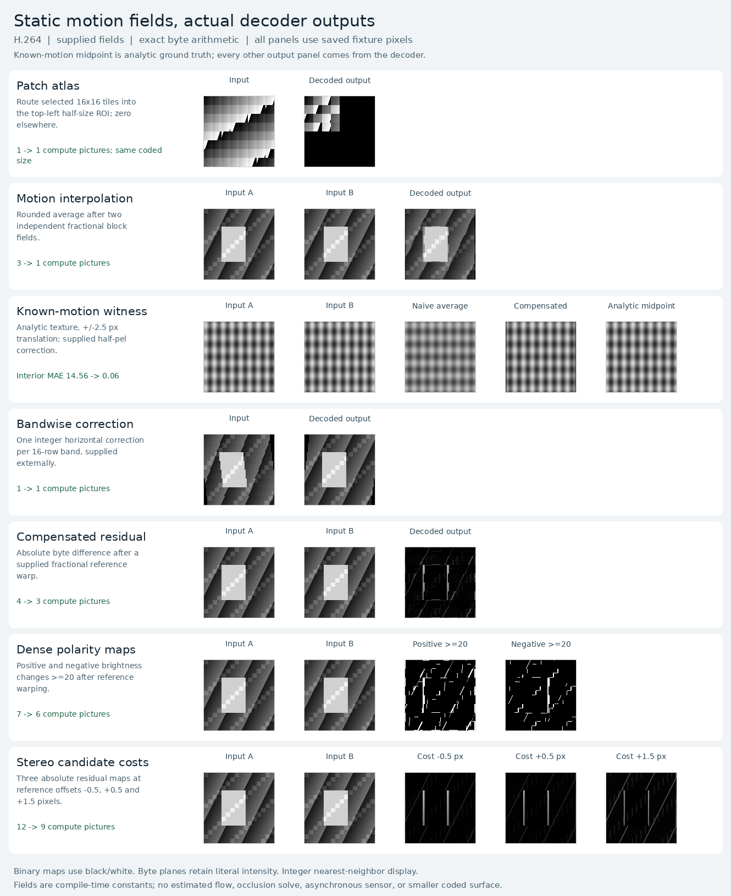

# Static-field resampling experiments

**Motion-compensated interpolation is the strongest architectural fit here.**
Two independently warped inputs and their rounded average fit into one H.264
prediction picture. Patch routing and bandwise correction each take one picture
as well. Compensated residuals, dense polarity maps, and stereo candidate costs
execute exactly, with progressively longer arithmetic chains.

These are experiments with **externally supplied static motion fields**. They do
not estimate optical flow, solve occlusions, model a physical rolling shutter, or
produce asynchronous/logarithmic sensor events. The compiler specializes each
field into a cached prediction tail; changing input pixels does not change that
tail. Updating a field requires another compile/export.



## Tasks and exact costs

All tasks operate on **128×128 byte images**, with **160×160 coded I420 surfaces**.
The table counts computation pictures; upload pictures are listed separately.
Baseline materializes spatial reads; fused mode moves eligible reads directly
into their scalar consumers, independently for each source of a B prediction.

| Task | Inputs | Baseline → fused compute pictures | Fused prediction bytes | Interpretation |
| --- | ---: | ---: | ---: | --- |
| Patch atlas | 1 | 1 → 1 | 587 | Route selected 16×16 tiles into a 64×64 ROI; zero the remainder. |
| Motion interpolation | 2 | 3 → 1 | 771 | Average two independently sampled fractional block fields. |
| Bandwise correction | 1 | 1 → 1 | 505 | Apply one integer horizontal offset per 16-row band. |
| Compensated absolute residual | 2 | 4 → 3 | 2,094 | Absolute difference after a fractional reference warp. |
| Dense polarity maps | 2 | 7 → 6 | 3,492 | Two masks: current−warped-reference ≥20 and reverse difference ≥20. |
| Stereo candidate costs | 2 | 12 → 9 | 5,901 | Three absolute difference maps, without aggregation or disparity selection. |
| Passthrough control | 1 | 0 | 0 | Return the uploaded input picture. |
| Unwarped average control | 2 | 1 | 642 | Average the exact same two inputs used by motion interpolation. |

Patch routing changes pixel placement within the existing surface. Its 64×64
active ROI **does not reduce coded geometry, decode work to a 64×64 surface, or
readback allocation**. Each selected 160×160 I420 picture still returns 38,400
bytes. The single-input passthrough control has its own fixture at this geometry;
it supplies coarse startup/upload context, not a matched subtraction for atlas
or rolling-shutter timing. The average control is a matched two-input baseline.

The stereo candidates use **reference read offsets** of −0.5, +0.5, and +1.5
pixels: an output pixel at `x` reads the reference at `x + offset`. They are dense
cost maps, not a depth or correspondence solution. The polarity maps are dense
frame-difference thresholds on literal byte brightness, with no event timestamps
or logarithmic response.

## Codec-defined sampling and quality witness

`media.gather(image, offsets, block_size=16, border="zero")` expresses integer
block reads. `media.sample_h264(image, qx, qy)` and `media.gather_h264(image,
offsets, block_size=16)` deliberately name H.264's quarter-pixel luma filter.
Those fractional operations use its six-tap filtering, specified rounding and
clipping; they do not promise another codec's or a generic bilinear filter's
pixels. Motion offsets are relative source reads, in pixel or quarter-pixel
units respectively. This experiment uses H.264 only.

The main interpolation case supplies two different fractional fields, including
different horizontal and vertical phases per block. Both inputs keep distinct
fields when fused into a single prediction. Image boundaries extend with zero
before filtering, and the resulting edge samples are checked exactly.

A separate controlled witness uses a nonlinear analytic sinusoidal texture
translated by **±2.5 pixels**. It decodes both an ordinary average and a compensated
average using the known half-pixel offsets, and compares them with the analytic
midpoint on an interior **112×112 crop**. That crop excludes displacement and
filter support at image edges. The witness demonstrates the value of supplied
motion on this texture; it is not evidence about estimated flow, real video
quality, disocclusions, or a broad image distribution. The capture labels the
analytic midpoint separately from actual decoded outputs.

Actual FFmpeg, OpenH264, VA-API, and NVDEC output gives an interior mean absolute
error of **14.55692** for the naive average and **0.0602679** for the compensated
average, in byte sample units. The compensated maximum absolute error is **1**.
NVDEC independently reproduces the complete saved I420 and recomputes both error
metrics from its returned output pixels. This controlled nonlinear witness
therefore demonstrates more than the linear-ramp identity that an unwarped
average could already satisfy.

## Measured finite-batch costs

The [NVDEC report](assets/nvdec.json) records these median elapsed milliseconds
for **eight independent 128×128 jobs**, with one warmup and five repetitions:

| Case | Input serialization | Saved streams, all pictures | Saved streams, named outputs | Host inputs to named outputs |
| --- | ---: | ---: | ---: | ---: |
| Patch atlas, fused | 85.94 | 315.52 | 327.93 | 411.78 |
| Interpolation, unfused | 166.60 | 369.71 | 368.41 | 533.35 |
| Interpolation, fused | 164.43 | 330.05 | 342.99 | 490.91 |
| Bandwise correction, fused | 89.45 | 306.30 | 310.41 | 394.34 |
| Compensated residual, fused | 166.42 | 373.11 | 368.48 | 537.10 |
| Dense polarity maps, fused | 159.88 | 420.91 | 413.50 | 573.20 |
| Stereo candidate costs, fused | 162.39 | 512.11 | 490.28 | 659.56 |
| Passthrough control | 87.60 | 283.16 | 275.97 | 364.21 |
| Unwarped average control | 161.22 | 340.66 | 343.01 | 495.92 |

In this run, interpolation fusion reduces the selected-readback median from
**368.41 to 342.99 ms**, and the directly measured host-to-output median from
**533.35 to 490.91 ms**. Its matched unwarped-average control is similar at
343.01/495.92 ms. These are bounded finite-batch measurements with startup,
serialization, I/O, and exact validation included as described below.

The [FFmpeg report](assets/ffmpeg.json) contains the same protocol and counters.
Its interpolation unfused → fused medians are **41.17 → 38.52 ms** for saved
streams with selected outputs and **65.60 → 64.41 ms** for host inputs to outputs;
the average control is 39.54/60.43 ms. Across all nine timed cases, FFmpeg's
selected-output medians span 35.52–41.75 ms. The two decoder environments differ,
so these numbers are not a controlled CPU-versus-hardware speed comparison.
The five-sample FFmpeg ranges overlap; those measurements do not establish a
reliable timing gain from fusion.

Startup and uploads remain large costs: a single-job NVDEC selected-output run
takes 258–292 ms across the cases, while serializing eight two-input jobs alone
takes 160–167 ms. Selected NVDEC copies can be much smaller than full copies
without a corresponding timing win. For fused interpolation, eight jobs decode
24 pictures but copy eight selected pictures, **921,600 → 307,200 I420 bytes**.
The unfused plan decodes 40 pictures and returns the same eight output pictures.
Both paths still upload every input. FFmpeg always copies all decoded pictures.

Architectural fit and measured benefit therefore differ. Supplied-field
interpolation shows the clearest combination of a native one-picture mapping,
controlled quality evidence, and a measured reduction against materialized
warps. Atlas routing and bandwise correction fit the native read mechanism but
show no smaller surfaces or proven application speedup. Residuals are compact
enough to keep investigating. The six- and nine-picture polarity/stereo chains
are less attractive runtime candidates here. There is **no CUDA, optimized CPU
image-kernel, or concurrent-workload baseline**, and no claim of general GPU
acceleration or steady-state video throughput.

## Saved evidence

The full [bundle index](assets/bundle.json) contains **113 streams, 588 pictures,
and 162 named outputs covering 2,654,208 pixels**. The three local decoders perform
**339 stream checks**. Both benchmark environments independently validate every
saved stream before timing, including the quality witness, totaling **22,579,200
I420 bytes per environment**. Every timed trial also compares every returned I420
byte and named output with its frozen exact reference. The final shared-IR suite
passes **165 tests with no skips**, including six workload/capture tests.

The committed subset contains **15 representative streams and 77 pictures**:
the first fixture of every baseline/fused task, both controls, and the quality
witness. Its [suite index](assets/suite.json), matching manifests, full I420
references, inputs/outputs, motion fields, and prediction tails are included.
Both complete timing reports, the full bundle index, the capture, and its
[provenance](assets/capture.capture.json) are also committed. The full eight-job
corpus stays under ignored `codec_compute/artifacts/resampling`; regenerate it
for the benchmark. The capture can also be regenerated directly from `assets`.

All reports pin source commit `b40e3c4` and bundle SHA256
`0652fb43cd00990e8e91155672ef4a180d6687735c2d1746e0a318b00958d0dc`.
Source hashes, exact artifact hashes, raw timing samples, decoder/helper hashes,
and actual decoded/copied/returned byte counters remain in the JSON evidence.

## Validation and benchmark protocol

Preparation uses eight changing fixtures per task: fixed scenes and deterministic
full-byte noise, with static fields shared by every fixture. Each named output
must match both the semantic IR and independent task formulas. Fractional task
references use the original compiler's separately tested normative interpolation
helper; the shared IR uses its own sampling module. Saved streams are decoded by
FFmpeg, OpenH264, and available VA-API. The exporter checks complete I420 equality
across decoders, all named outputs, zero guard luma, and neutral chroma, then saves
the actual decoded planes and their hashes.

The portable runner compares against those **frozen independently validated
references**; it does not rerun compiler synthesis or fractional formulas. It
validates every baseline/fused stream, both controls, and the known-motion witness
before timing, including untimed variants. It also recomputes witness errors from
actual returned pixels and the saved analytic midpoint. Capture generation
requires passing decoder evidence and binds every displayed input/output plane
to its exact crop in the saved full I420 frame. Binary masks display 0/1 as
black/white; other planes retain literal byte intensity.

Timing covers all fused tasks, both controls, and the unfused interpolation
baseline, with batches of **one and eight independent jobs**. Each case/batch/mode
gets one warmup and five measured repeats, with rotating order. Reports preserve
all samples and medians. Four modes remain separate:

| Mode | Included work |
| --- | --- |
| Input serialization | Validate and serialize already loaded input boards into I_PCM pictures; compare each prefix byte with its prepared reference. |
| Pre-encoded, all pictures | Batch assembly and file I/O, process/pipeline startup, parsing, decoding, all surface copies, diagnostics, and exact returned-I420/named-output checks. |
| Pre-encoded, named outputs | Same scope with deduplicated output-picture selection. NVDEC skips unselected surface copies; FFmpeg copies all pictures before selecting in Python. |
| Host inputs to named outputs | Measured directly: serialize/check inputs, append the cached tail, write streams, then run the selected-output decode path. |

Compilation, motion-field setup, fixture/reference generation and loading,
source/hash auditing, initial guard checks, network transfer, and report writing
are outside timing. No cache-flushing protocol is used. Every decode call opens
a new session and runs a finite batch to EOS. Per-job figures are amortized
throughput, not individual latency or steady-state decoder throughput. No GPU
arithmetic baseline, concurrent GPU workload, or energy result is claimed.
FFmpeg and NVDEC run in separate environments, so their absolute timings cannot
isolate hardware performance.

The uploader explicitly probes 256×256 zero and byte-ramp inputs. Both are rejected
by the existing High level 3.1 initial I_PCM access-unit limit. No large-image
support is inferred from the semantic graph's ability to represent those shapes.
Input escaping makes some near-limit shapes content dependent; the measured
128×128 canvas accepts the complete byte fixtures here.

## Reproduce

From the repository root:

```sh
python3 -m unittest codec_compute.tests.test_resampling_workloads -v
python3 -m codec_compute.workloads.resampling.demo \
  --output codec_compute/artifacts/resampling --size 128 --jobs 8
python3 -m codec_compute.workloads.resampling.capture \
  codec_compute/artifacts/resampling \
  --output codec_compute/artifacts/resampling/capture.png
python3 codec_compute/workloads/resampling/benchmark.py \
  codec_compute/artifacts/resampling --backend ffmpeg \
  --batch-sizes 1 8 --repeats 5 \
  --output codec_compute/artifacts/resampling/ffmpeg.json
```

For a short correctness export, use `--size 32 --jobs 2`; its runner must use
`--batch-sizes 1 2`. The default export prepares eight jobs to match benchmark
defaults. The complete generated corpus stays under ignored `codec_compute/artifacts/`.

The NVDEC host needs the prepared bundle, this directory's `benchmark.py`,
`codec_compute/workloads/temporal_benchmark.py`, and
`decoder_core/{__init__,decode,bitstream}.py` with their relative layout preserved.
The runner uses Python 3.8 and the standard library, plus the existing decoder
helper. The identical Writer source loads with postponed annotations and every
serialized input prefix is checked byte for byte; no compiler installation is
required on that host.

```sh
python3 codec_compute/workloads/resampling/benchmark.py \
  codec_compute/artifacts/resampling --backend nvdec \
  --helper /path/to/nvdec_decode --batch-sizes 1 8 --repeats 5 \
  --output nvdec.json
```

`--cases` can select exact bundle case keys for timing; full validation still
covers all prepared streams. `suite.json` additionally supports the existing
`05-h264-compiler/optimizations/ir/validate.py` portable validator.
