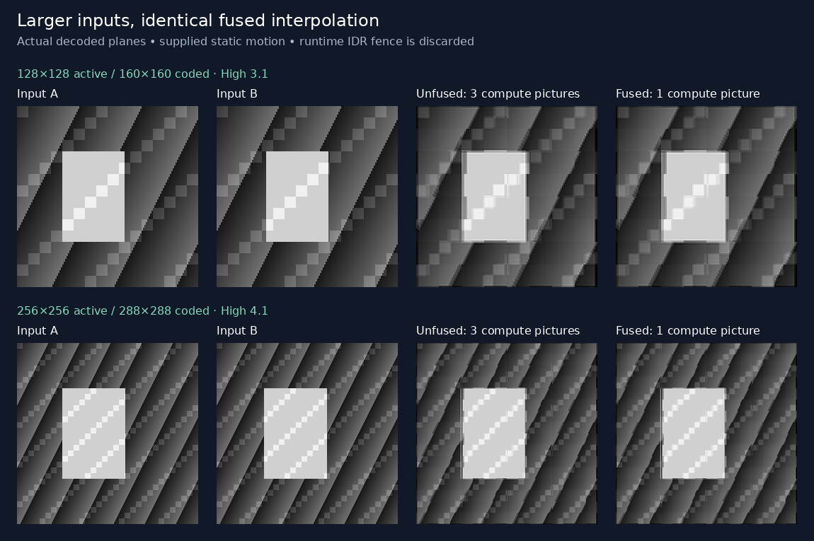

# Larger inputs and resident NVDEC execution

This experiment extends the shared compiler in two ways: explicit High level
4.1 permits arbitrary 256×256 input images, and a resident runtime submits
independent jobs through one live decoder pipeline. Every job still uploads
its inputs. Motion fields remain compile-time constants.

```python
import codec_compute as media

def halfway(a, b):
    return media.average(media.sample_h264(a, 10, 0),
                         media.sample_h264(b, -10, 0))

program = media.compile(halfway, width=256, height=256, h264_level=41,
                        input_ranges={"a": (0, 255), "b": (0, 255)})
with program.session(helper="/path/to/nvdec_decode") as session:
    for inputs in input_pairs:
        result = session.run(inputs)["output"]
# Successful close also checks delayed hardware diagnostics and final drain.
```

The default level remains 3.1 and preserves existing valid bitstream bytes.
Level 4.1 is explicit, with checked geometry, DPB, slice rate, access-unit size,
and conservative per-picture bitrate limits. It is a bounded accepted subset,
not unrestricted large-image support or a complete HRD simulator. See
[level limits](../../../decoder_core/LEVELS.md).

## Completing a request without EOS

The tested NVDEC pipeline retains the end of a short reference chain until
another IDR or EOS. An ordinary P prediction, access-unit delimiter, and
end-of-sequence NAL did not release it in our probes. The runtime appends a tiny,
discarded IDR fence, encoded with constant-128 intra prediction and zero residual.
It costs **one additional decoded picture**, but only **149 bytes at 128×128**
or **372 bytes at 256×256**, with the coded guard geometry included.

Input IDRs use identifier 0; fences use 1, as consecutive IDRs must have distinct
identifiers. The following job resets references again. Intermediate computation
pictures remain in the DPB within each job; the fence deliberately prevents
references from carrying between jobs. This is session reuse, not streaming
camera input reuse. The ordinary saved program and its manifest's computation
picture count exclude the runtime fence; runtime reports count it separately.
See [fence grammar and verification](../../../decoder_core/FENCES.md).

The worker receives one compiler-framed access unit per picture through an
inherited Unix socket. GStreamer `appsrc` feeds the decoder directly using
AU-aligned buffers; monotonically assigned timestamps identify every output.
Results return before the next job is submitted. Only selected result pictures
are copied back as I420; earlier fences are discarded, and the final fence is
drained at the sole shutdown EOS. Errors, count/timestamp mismatches and timeouts
poison the worker. Always close the session: delayed diagnostics are checked then.

## Measurement boundaries

The prepared bundle contains eight changing fixtures per case, at 128×128 and
256×256. Cases are materialized interpolation, fused interpolation, an unwarped
average using the same inputs, and single-input passthrough. Extreme zero/255
fixtures exercise escape-heavy input uploads. Every saved stream includes its
fence and is checked through FFmpeg, OpenH264 and VA-API against an independent
task formula and the semantic IR, including full I420, guards and chroma.

The portable runner loads frozen references and runs no compiler or image
arithmetic. Before timing, it submits every fixture through live sessions with
full real-picture readback. Timed requests select named outputs and compare
every returned I420 byte. The five modes are:

| Mode | Timed work |
| --- | --- |
| Input serialization | Encode already loaded input boards; compare exact prefix bytes. |
| Cold, pre-encoded | Start a worker/pipeline per request, submit prepared AUs/fence, receive/check output, close/EOS/check diagnostics. |
| Resident, pre-encoded | After one complete warmup, submit/check sequential requests through the same live pipeline. |
| Cold, host input | Cold path plus input serialization and exact prefix check. |
| Resident, host input | Warm resident path plus input serialization and exact prefix check. |

Each trial uses all eight jobs, with five repeats and rotating case/mode order.
Resident creation, warmup and final close are recorded separately from timed
requests. The constructor handshake alone does not warm the decoder. Cold and
resident modes use the same AU protocol, inputs, instruction bytes, fences and
output selection. Compilation, reference generation/loading, initial source and
artifact audits, network transfer and report writes are excluded. Raw per-request
and per-trial samples and actual copy/fence counters remain in the report.
The public `Program.session.run` additionally validates graph inputs and converts
named output planes to Python lists; those application-level conversions are
outside this portable low-level benchmark.

These results measure this implementation, including socket copies, diagnostics
and correctness checks. They do not establish a CUDA advantage, zero-copy output,
concurrent GPU performance, changing motion fields, or reuse of camera references.

## Results

The [complete NVDEC report](assets/nvdec.json) passes all five timing repeats
and all **64 correctness jobs**: **256 decoded pictures including 64 fences**,
with every real picture checked (**192 I420 readbacks, 15,630,336 bytes**).
Local verification passes 192 checks through three decoders. The shared compiler
and decoder-core suites pass 172 and 68 tests, respectively.

For fused interpolation, timings below are milliseconds per request: the median
of five eight-request trials, divided by eight. Inputs change each request.

| Active size | Input serialization | Cold, pre-encoded | Warm resident, pre-encoded | Cold, host input | Warm resident, host input |
| --- | ---: | ---: | ---: | ---: | ---: |
| 128×128 | 19.40 | 276.33 | 10.60 | 297.40 | 29.05 |
| 256×256 | 65.15 | 276.43 | 15.17 | 342.22 | 78.99 |

Cold measurements include creation and shutdown for every request. Warm resident
measurements exclude each trial's creation, one complete warmup, and final close.
Including those recorded phases and the extra warmup, amortized over the eight
timed requests, resident host-input medians are **64.97 and 132.82 ms/request**,
respectively. These are computed by summing phases *within each trial* before
taking the median, not by adding independent medians. Startup therefore matters
for short sessions; the smaller warm values describe ongoing use.

Fusion remains useful after startup is removed. Three computation pictures become
one (six total pictures including inputs/fence become four). Warm pre-encoded
interpolation falls **14.51 → 10.60 ms** at 128×128 and **21.91 → 15.17 ms** at
256×256, about 27% and 31%. With host input, the same comparisons are
**33.27 → 29.05 ms** and **85.92 → 78.99 ms**, about 13% and 8%. The matched
unwarped-average control measures 10.25/14.00 ms pre-encoded; single-input
passthrough measures 5.95/7.99 ms. Each control still includes its IDR fence.

The clearest next performance target is input serialization: its separately
measured 65.15 ms at 256×256 is large relative to the measured 78.99 ms complete
warm host-input path. This identifies a substantial host-side cost; subtracting
independent mode medians would not establish decoder-only time. Five repeats on
one NVDEC setup do not establish performance across hardware or production
reliability. Raw per-trial ranges remain in the report; for example, 256×256
resident host-input trials span 78.04–95.27 ms/request.



The [capture provenance](assets/capture.json) binds panels to decoded pixels.
The committed [representative bundle](assets/bundle.json) contains one fixture
per case: eight streams and 32 pictures. The benchmark instead binds to the
[full 64-stream bundle index](assets/full-bundle.json); regenerate its complete
fixtures with `prepare` below. Its source revision is `c7f0b4d`, and the report
also records every relevant source hash and the helper binary hash.

## Reliability observation

An earlier full benchmark stopped during a cold host-input session's shutdown,
after all 64 correctness jobs and the first timing repeat passed. Its wrapper
reported EOF before the final response but discarded the native diagnostic,
so the cause remains unknown. That interrupted run is preserved as
[raw partial results](assets/interrupted-run.json) with its
[original bundle index](assets/interrupted-bundle.json); its partial timings are
not used for performance conclusions. The runtime now preserves worker diagnostics
and exit status on failure. These changes improve diagnosis; the original
shutdown failure remains unresolved. During investigation, 360 targeted
reproduction sessions completed without reproducing the failure; their console
logs were not retained. They are an observation, not a second archived benchmark.
The subsequent full five-repeat run linked above passed on the runtime with
improved failure reporting.

## Reproduce

```sh
python3 -m codec_compute.workloads.resident.prepare \
  --output codec_compute/artifacts/resident --sizes 128 256 --jobs 8
python3 codec_compute/workloads/resident/benchmark.py \
  codec_compute/artifacts/resident --helper /path/to/nvdec_decode \
  --repeats 5 --output codec_compute/artifacts/resident/nvdec.json
python3 -m codec_compute.workloads.resident.capture \
  codec_compute/artifacts/resident \
  --output codec_compute/artifacts/resident/capture.png
```

The decoder host needs Python3.8+, the prepared bundle, `decoder_core` runtime
sources and compiled helper, this portable benchmark, and the existing
`temporal_benchmark.py` helper with their relative paths preserved. It does not
need the compiler, synthesis engine, image oracle, Pillow or model dependencies.
Build the helper with [build_nvdec.sh](../../../decoder_core/build_nvdec.sh).
